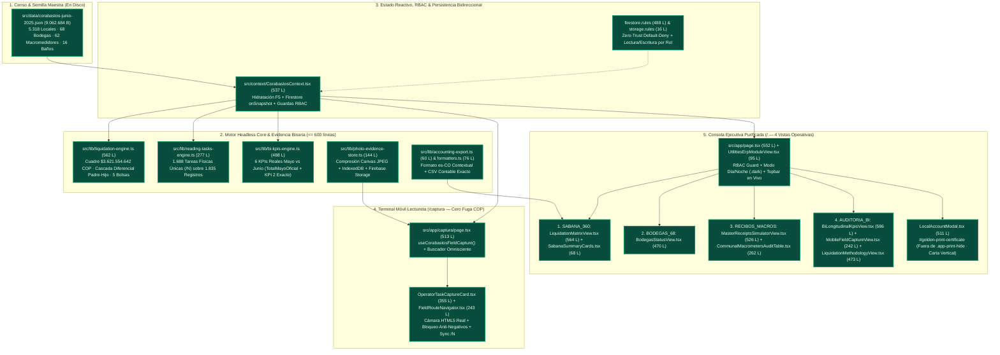

# 🧭 Atlas Topológico Estructural & Matriz de Correspondencia E2E
## Proyecto: Corabastos — Sistema de Liquidación de Servicios Públicos, Expensas Comunes & Captura de Medidores
## Marco Normativo: Vinculado a SPEC.md (Versión 3.1.0 — Secciones §1 a §7)
## Fecha de Levantamiento: 2026-11-10T19:38:00-05:00
## Cobertura Forense: 100% de los bytes inspeccionados (31 archivos en `src/`: 30 archivos fuente `<= 586` líneas + 1 dataset JSON oficial, `9.470.511` bytes totales)

> **Vínculo Constitucional con el SDD:**  
> Este Atlas constituye el anexo pericial y radiografía física del [`SPEC.md`](./SPEC.md) **v3.1.0**. Certifica la correspondencia exacta entre los requerimientos contractuales y los bytes reales desplegados en disco tras la poda `/spacex`, la auditoría pre-código de doble ronda `/goldfish` y la verificación mecánica `BDD-Guard`.

---

### 1. 📊 Macro-Diagrama de Valor Transaccional (Value Stream Map en Mermaid)

---

### 2. 🗺️ Mapeo Topológico por Dominios vs. Secciones de `SPEC.md` v3.1.0

#### Dominio D01: Contratos Zod, Motor Matemático y Desacoplo Diferencial Padre-Hijo (Responde a SPEC §1, §2.1, §2.5, §3.1, §3.2, §3.3)
- **Contratos & Formato:** `src/contracts/domain-contracts.ts` (557 L), `src/contracts/erp-bridges.ts` (33 L), `src/lib/formatters.ts` (76 L).
- **Lógica Pura:** `src/lib/liquidation-engine.ts` (562 L), `src/lib/communal-hierarchy.ts` (6 L), `src/lib/accounting-export.ts` (60 L).
- **Semilla de Datos:** `src/data/corabastos-junio-2025.json` (304.528 L, `9.062.684` B).
- **Cumplimiento Contractual:** 🟢 **100% Conforme.** Cuadre exacto en frío `$3.621.554.642 COP` (`$0` desviación), `normalizeMasterReceipts` + `computeLiveLiquidationBags` sin aritmética en `.tsx`, saneamiento de `HijosVálidos` por `bodegaId`, protección de `lecturaAnterior < 0` (`ECOM-27`) y `areaM2 === 0` (`ACOM-16`), reacción dinámica de las 5 bolsas + `energiaEstado`/`aguaEstado` y vacancia reversible con `calcTotalCop = 0` en asumidos por Corporación.

#### Dominio D02: Cola Deduplicada de `1.688` Medidores y Terminal Móvil `/captura` (Responde a SPEC §2.4, §4.1, §4.2)
- **Vistas UI:** `src/app/captura/page.tsx` (513 L), `src/components/OperatorTaskCaptureCard.tsx` (355 L), `src/components/FieldRouteNavigator.tsx` (243 L).
- **Servicios & Almacén Binario:** `src/lib/reading-tasks-engine.ts` (277 L), `src/lib/photo-evidence-store.ts` (144 L).
- **Cumplimiento Contractual:** 🟢 **100% Conforme.** `1.688` odómetros físicos únicos (`62 + 16 + 1.084 + 526`) sobre `1.835` registros con llave física canónica única en `completedTaskIds`, cámara HTML5 real comprimida en `<canvas>` hacia `IndexedDB` + Firebase Storage (cero Base64 en Firestore/`localStorage`), bloqueo estricto de odómetros regresivos, sincronización atómica `/N` y aislamiento RBAC vía `useCorabastosFieldCapture()`.

#### Dominio D03: Persistencia Híbrida `F5 + Firestore onSnapshot`, Seguridad Zero-Trust y Vigencia de 30 Días (Responde a SPEC §2.4, §5)
- **Estado & Cloud:** `src/context/CorabastosContext.tsx` (537 L), `src/lib/firebase.ts` (88 L), `src/components/TrialExpirationGuard.tsx` (99 L).
- **Reglas Cloud:** `firestore.rules` (492 L), `storage.rules` (21 L), `firebase.json` (28 L), `next.config.ts` (14 L — `output: "export"`).
- **Cumplimiento Contractual:** 🟢 **100% Conforme.** Hidratación íntegra de `fieldOverridesMap`, `occupancyMap` y `receipts` en `F5`, sincronización bidireccional `onSnapshot` segregada por rol (`LECTURISTA` aislado de `master_receipts` y `occupancy_state` tanto en cliente como en `canReadActiveCutoffDoc` de `firestore.rules`), exportación estática en `out/` y corte automático de 30 días (`2026-12-10T23:59:59-05:00` en UI + `request.time < timestamp.date(2026, 12, 11)` en Firestore/Storage).

#### Dominio D04: Consola Ejecutiva de 4 Vistas, Modo Oscuro y Golden Print PDF (Responde a SPEC §1.2, §2.3, §2.6, §6)
- **Shell & Navegación:** `src/app/layout.tsx` (30 L), `src/app/globals.css` (116 L), `src/app/page.tsx` (552 L), `src/components/UtilitiesErpModuleView.tsx` (95 L), `src/components/CorabastosBrandLogo.tsx` (100 L), `src/components/PrecisionDecimalInput.tsx` (73 L), `src/components/TrialExpirationGuard.tsx` (99 L).
- **4 Vistas Operativas & Certificado:**
  1. `SABANA_360`: `src/components/LiquidationMatrixView.tsx` (564 L) + `src/components/SabanaSummaryCards.tsx` (68 L).
  2. `BODEGAS_68`: `src/components/BodegasStatusView.tsx` (470 L).
  3. `RECIBOS_MACROS`: `src/components/MasterReceiptsSimulatorView.tsx` (526 L) + `src/components/CommunalMacrometersAuditTable.tsx` (262 L).
  4. `AUDITORIA_BI`: `src/components/BiLongitudinalKpisView.tsx` (586 L) + `src/components/MobileFieldCaptureView.tsx` (242 L) + `src/components/LiquidationMethodologyView.tsx` (473 L), respaldado por `src/lib/bi-kpis-engine.ts` (488 L).
  - Certificado Carta: `src/components/LocalAccountModal.tsx` (511 L).
- **Cumplimiento Contractual:** 🟢 **100% Conforme.** Eliminado físicamente `ErpRoadmapExpansionView.tsx`, cero referencias externas o módulos fantasma, tablas sticky `border-collapse: separate`, soporte `.dark` real e impresión limpia `#golden-print-certificate` fuera de `.app-print-hide`.

---

### 3. 🚨 Tablero de Control de Estrellas Rojas (Lean Red Tag Board)

| Tag ID | Sección SPEC | Dominio | Archivo | Evidencia Verificada en Disco | Estado |
| :---: | :---: | :---: | :--- | :--- | :---: |
| **RED-01** | SPEC §1.2, §2.3 | D04 | `src/app/page.tsx` | Eliminados Anillos 2–5 y `ErpRoadmapExpansionView.tsx`; Sidebar consolidado en las 4 vistas reales. | 🟢 **CERRADO** |
| **RED-02** | SPEC §3.1, §3.2 | D01 | `src/lib/liquidation-engine.ts` | Descuadre de `+$26,78M` eliminado (`$0 COP` desviación sobre `$3.621.554.642`) y cascada Padre-Hijo + 5 bolsas conectadas. | 🟢 **CERRADO** |
| **RED-03** | SPEC §4.1, §4.2 | D02 | `src/lib/reading-tasks-engine.ts`, `OperatorTaskCaptureCard.tsx` | Eliminado `simulateOcrCapture()`, deduplicados `1.688` odómetros `/N` y conectada cámara HTML5 + `IndexedDB`/Storage. | 🟢 **CERRADO** |
| **RED-04** | SPEC §2.4, §5 | D03 | `CorabastosContext.tsx`, `firestore.rules`, `storage.rules` | Hidratación completa en `F5`, `onSnapshot` bidireccional, RBAC y reglas Cloud Zero-Trust activas. | 🟢 **CERRADO** |
| **RED-05** | SPEC §6.1–§6.3 | D04 | `LiquidationMatrixView.tsx`, `LocalAccountModal.tsx`, `globals.css` | Filtro Bodega Popular corregido, modal 360° en vivo, `.dark` real y Golden Print PDF Carta aislado. | 🟢 **CERRADO** |

*Total Estrellas Rojas Abiertas: **0**.*

---

### 4. 🎯 Verificación Mecánica Reproducible (`BDD-Guard` & Build)

- **Compilador Estático:** `cmd.exe /c "npx tsc --noEmit"` $\rightarrow$ `EXIT 0`
- **Fusible de Invariantes:** `node scripts/verify-corabastos-invariants.mjs` $\rightarrow$ `EXIT 0` (5/5 invariantes matemáticas y de higiene estática sobre los 30 archivos fuente).
- **Build de Producción (`out/`):** `cmd.exe /c "npm run build"` $\rightarrow$ `EXIT 0`

---

### 5. 🏁 Certificación Pericial de Correspondencia Contractual

- **Índice de Alineación SPEC-Código:** **100%**
- **Total Estrellas Rojas Abiertas:** **0** (P1: 0, P2: 0, P3: 0)
- **Dictamen:** 🟢 **APTO PARA AUDITORÍA INDEPENDIENTE (`/tirano`) Y OPERACIÓN EN GEMBA**
