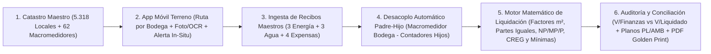

# 🛡️ CORABASTOS OS (ERP Corporativo & Motor de Liquidación de Servicios Públicos y Expensas Comunes) — Contrato Canónico de Arquitectura (SPEC.md)

> **Documento Canónico de Especificación (Spec-Anchored — SDD)**  
> **Versión:** 1.0.0 (Ingeniería Inversa Integral de `06. LIQUIDACION JUNIO 2025.xlsm` + Estrategia Land & Expand ERP inspirada en `frufresco` + Stack Técnico `Seguridad / Help! On Risks`)  
> **Fecha de Actualización:** 23 de Octubre de 2026  
> **Estado:** 🟢 VIGENTE & 100% BLINDADO PARA CONSTRUCCIÓN  
> **Ubicación Oficial:** `C:\Users\German Higuera\OneDrive\Documentos\Projects\corabastos`  
> **Puerto Dev Oficial Asignado:** `3013` (Registrado e Innegociable en `PROJECTS_PORTS_REGISTRY.md`)  
> **Principio Rector:** *«El código ya no es la fuente de la verdad; la especificación y los contratos de frontera lo son. El código es solo un subproducto derivado del contrato.»*

---

## 0. Leyes Marciales de Arquitectura, Estrategia Comercial "Land & Expand" & Gobernanza SDD

### 0.1 Las 5 Leyes Innegociables de Ingeniería (`arquitecto-sdd`)
1. **Contract-First Schema & Diccionario Único de Identidad (`src/contracts/domain-contracts.ts`):**
   - Prohibición absoluta de ambigüedades entre módulos. Los códigos de local (`codigoLocal`, ej. `"010001"`, `"02004B"`, `"980031"`), indicadores de bodega (`bodegaId`, ej. `"01"`..`"98"`), modalidades de cobro (`CONTADOR`, `COMUNAL`, `PRORRATEO`, `RED_FRIOS`, `BASICOS`) y planos contables (`PL109`, `PL008`, `PL009`, `PL003`, `PL007`, `PL004`, `PL141`, `PL253`, `PL086`, `PL087`, `PL250`, `AMB403`, `AMB408`) se rigen por un único contrato tipado en TypeScript + Zod (`< 250 líneas`).
2. **Headless Core + Thin UI (Prohibición de Monolitos `.tsx > 600 líneas`):**
   - **Headless Engine (`src/lib/liquidation-engine.ts`, `src/lib/communal-hierarchy.ts`, `src/lib/accounting-export.ts`):** Funciones puras, deterministas, sin dependencias de React, que ejecutan el cálculo exacto al centavo sobre los **5.318 locales** y los **62 macromedidores comunales**.
   - **Thin UI (`src/components/**/*.tsx`):** Vistas modulares (`<= 600 líneas`) dedicadas exclusivamente a captura móvil en terreno, auditoría tabular y visualización ejecutiva.
3. **Estrategia de "Cables Pelados" (*Clean Boundary Harness*) & Escalamiento ERP Modular:**
   - El **Módulo 1 (Captura Móvil de Contadores + Liquidación de Servicios Públicos y Expensas)** es nuestro **Caballo de Troya ("Boleto de Entrada")** a la Corporación de Abastos de Bogotá S.A. (Corabastos).
   - La arquitectura nace con **"Cables Pelados"** (`src/contracts/erp-bridges.ts`) listos para enchufar progresivamente los módulos subsiguientes del ERP Administrativo (inspirados en la arquitectura probada de `frufresco` e `ingyemel_mantenimiento`) a medida que se cierren nuevas fases comerciales, sin reescribir el núcleo.
4. **Máquina de Estados Explícita (FSM) con Peaje de Evidencia en Terreno:**
   - Ninguna lectura de medidor ni periodo de liquidación cambia de estado en memoria volátil; toda transición persiste en Firebase v12 (`firestore`) con fallback offline-first en `localStorage`/`IndexedDB` para operación sin señal dentro de bodegas y sótanos de Corabastos.
5. **Iconografía Vectorial Exclusiva `lucide-react`:**
   - Prohibición total de emojis de texto Unicode (`⚡`, `💧`, `⚠️`, `✅`, etc.) en cualquier componente visual, botón, badge o reporte PDF. Uso exclusivo de íconos vectoriales `lucide-react` (`strokeWidth={1.75}`).

---

### 0.2 Hoja de Ruta Comercial "Land & Expand" (Del Boleto de Entrada al ERP Integral Corabastos)

Inspirado en el ecosistema modular de **`frufresco`** y el chasis operativo de **`Seguridad (Help! On Risks)`**, el sistema está estructurado en **5 Anillos de Expansión Comercial** visibles en la arquitectura del portal:

| Anillo / Fase Comercial | Módulo del ERP Corabastos | Origen de Trasplante (`Arsenal` / Proyectos) | Estado en `v1.0` |
| :--- | :--- | :--- | :--- |
| **ANILLO 1 (Boleto de Entrada — MVP Activo)** | **1A. Terminal Móvil de Lecturistas en Terreno (PWA + OCR IA)** **1B. Motor de Liquidación de Servicios Públicos y Expensas (5.318 Locales)** **1C. Conciliación Financiera (`V/Finanzas` vs `V/Liquidado`), Sabana Excel y Planos Contables** | Ingeniería Inversa `06. LIQUIDACION JUNIO 2025.xlsm` + `frufresco` (`/ops/compras` mobile UX) + `galeria-sticky-industrial` | 🟢 **100% Operativo (Nucleo Core)** |
| **ANILLO 2 (Expansión Corto Plazo)** | **Facturación Electrónica DIAN, Estado de Cuenta Digital por Comerciante (Golden Print PDF + WhatsApp) & Portal de Recaudo / Cartera** | `frufresco` (`/admin/commercial/billing`, WorldOffice/ERP export, Cartera) + `REF-PDF-GOLDEN-PRINT-MEMBRETE.md` | 🔌 **Cable Pelado Listo (`billing-bridge.ts`) + Vista Previa Ejecutiva** |
| **ANILLO 3 (Expansión Mediano Plazo)** | **Gestión Inmobiliaria de Bodegas, Contratos de Arrendamiento/Cesión de Locales, Áreas ($m^2$) y Catastro Técnico de Medidores** | `frufresco` (`SpecialAgreementsModule`) + `Seguridad` (`Debida Diligencia / SAGRILAFT` de Arrendatarios) | 🔌 **Cable Pelado Listo (`real-estate-bridge.ts`)** |
| **ANILLO 4 (Expansión Operativa)** | **Mantenimiento Industrial & CMMS de Infraestructura (Red de Fríos, Subestaciones, Macromedidores, Cubiertas y Aleros)** | `ingyemel_mantenimiento` (`maintenanceLifecycle.ts`, OT Kanban, Cronograma Preventivo) | 🔌 **Cable Pelado Listo (`cmms-bridge.ts`)** |
| **ANILLO 5 (Expansión Integral)** | **Gestión Ambiental PGIRS (Pesaje en Acopio de Residuos `NP/MP/P`), Control de Accesos / Básculas y SAC / PQRS de Comerciantes** | `frufresco` (`SAC PQR Widget + RCA Audit Modal`, Control Operativo) | 🔌 **Cable Pelado Listo (`pgirs-sac-bridge.ts`)** |

---

## 1. Misión del Sistema & Cadena Causal del Pipeline (Anillo 1)

### 1.1 El Problema Físico en el Gemba (Corabastos Hoy)
Mensualmente, Corabastos distribuye cerca de **`$3.861.030.410 COP`** en servicios públicos y expensas comunes entre **5.318 locales comerciales** (`126.125,15 m²` de área comercial en 60+ bodegas). Hoy el proceso sufre 4 fracturas críticas:
1. **Captura Manual Frágil en Campo:** Los operarios recorren miles de locales tomando fotografías de contadores de agua y energía; luego esas lecturas se digitan manualmente en hojas auxiliares (`[1]ENERGIA`, `[1]ACUEDUCTO`) que alimentan con `VLOOKUP` una macro-sábana de 10.7 MB (`06. LIQUIDACION JUNIO 2025.xlsm`).
2. **Fórmulas "Espagueti" en Macromedidores Comunales:** Cuando un local dentro de una bodega comunal instala contador propio, en el Excel deben editar manualmente la fórmula del macromedidor de esa bodega para restar la celda exacta del local hijo (ej. en `AGUA COMUNAL` fila 17: `=(D17-C17)-ACUEDUCTO!$F$309-$F$310-...-$F$3344`, con hasta 22 restas manuales por celda y múltiples errores `#REF!`).
3. **Detección Tardía de Anomalías:** Si un contador está detenido (`C, DETENIDO`), tapado (`C, TAPADO`), invertido o registra un salto atípico frente a su banda histórica (`PROMEDIO <` / `PROMEDIO >`), el hallazgo solo se descubre semanas después en oficina cuando ya cerró el mes.
4. **Descuadre Contable (`V/FINANZAS` vs. `V/LIQUIDADO`):** Cruzar los 3 recibos maestros de Energía, los recibos de Acueducto y las 4 facturas de expensas (Aseo, Residuos ECSA, Vigilancia, Policía) con notas crédito/débito, exenciones de la Corporación/Covial y topes de factura mínima genera diferencias de millones de pesos difíciles de auditar.

### 1.2 Cadena Causal del Pipeline Digital (`Corabastos OS`)

---

## 2. Restricciones Técnicas & Stack (`Help! On Risks / Seguridad Standard`)

- **Framework & Runtime:** Next.js 16 (App Router con Turbopack) + React 19 + TypeScript 5 (`strict: true`, cero `any`).
- **Puerto Dev Oficial:** **`3013`** (`"dev": "next dev --turbopack -p 3013"`).
- **Base de Datos, Auth & Storage:** **Firebase v12** (`firebase/firestore`, `firebase/auth`, `firebase/storage`) idéntico al stack de `Seguridad (helponrisks)` con capa de persistencia reactiva + **Semilla Determinista Local** generada directamente desde `06. LIQUIDACION JUNIO 2025.xlsm` para que el sistema opere al 100% desde el primer segundo con los **5.318 locales reales de Junio 2025**.
- **Estilos & UI:** Tailwind CSS v4 + Paleta Institucional de Alta Densidad (Inspirada en el estándar corporativo Navy/Emerald/Amber/Crimson de `Seguridad` e `Ingyemel`, con tipografía tabular `font-mono tabular-nums` para lecturas de kWh, $m^3$, áreas en $m^2$ y cifras en pesos COP).
- **Validación de Esquemas:** `zod` (`^3.24.2`) para validación estricta de lecturas de medidores, recibos maestros y reglas de liquidación.

---

## 3. Ingeniería Inversa Forense: Las Reglas Matemáticas Exactas de Corabastos (`06. LIQUIDACION JUNIO 2025.xlsm`)

Todo cálculo del motor `src/lib/liquidation-engine.ts` debe reproducir con precisión matemática las fórmulas extraídas de las 11 hojas del libro oficial de Junio 2025:

### 3.1 Censo Maestro y Tipología de Locales (`RESUMEN TOTAL` — 5.318 Unidades)
Cada unidad o local comercial posee:
- `codigo` (`string`): Identificador único de 6 caracteres (ej. `"010001"`, `"02004B"`, `"840003"`). Los primeros 2 caracteres (`MID(codigo, 1, 2)`) determinan el `bodegaId` (`"01"` a `"98"`).
- `tipoBodega` (`string`): `"COMERCIANTES"`, `"BODEGA POPULAR"`, `"RED FRIOS"`, `"PESCADOS"`, `"BANCOS"`, `" ADMINISTRACION"`, `"BAÑOS"`, etc.
- `areaM2` (`number`): Área en metros cuadrados. Suma total del catastro: **`126.125,15 m²`**.
- `modalidadEnergia` (`'CONTADOR' | 'COMUNAL' | 'PRORRATEO' | 'RED_FRIOS' | 'EXCLUIDO'`).
- `modalidadAcueducto` (`'CONTADOR' | 'COMUNAL' | 'PRORRATEO' | 'RED_FRIOS' | 'EXCLUIDO'`).
- `bloqueEnergia` (`'PRINCIPAL' | 'BODEGA_POPULAR'`): Define si el local se liquida en la sábana `ENERGIA_` (3.463 registros) o en `ENERGIA BP` (1.851 registros).
- `categoriaResiduos` (`'NP' | 'MP' | 'P' | 'BASICOS' | 'EXCLUIDO'`): Clasificación generadora de residuos sólidos ECSA.

---

### 3.2 Algoritmo de Desacoplo Automático Padre-Hijo en Macromedidores Comunales (`LECTURAS COMUNALES_` y `AGUA COMUNAL`)

En lugar de las fórmulas manuales del Excel que restan celdas individuales (`-ENERGIA_!$F$14-$F$1606...`), el motor implementa la **Regla de Árbol Padre-Hijo por Bodega**:

1. **Macromedidores de Aleros de Energía (`26 medidores`, filas 2 a 27 de `LECTURAS COMUNALES_`):**
   - Miden la iluminación perimetral/alero de cada bodega (`bodegaId`).
   - $\text{Consumo Alero Bodega } b = \text{Lectura Actual}_b - \text{Lectura Anterior}_b$.
   - $\text{Área Total Bodega } b = \sum_{i \in \text{Bodega } b} \text{Área}_i$.
   - A cada local $i$ de la bodega $b$ (excepto modalidad `RED_FRIOS`) se le asigna:
     $$\text{kWh Alero}_i = \text{Área}_i \times \frac{\text{Consumo Alero Bodega } b}{\text{Área Total Bodega } b}$$

2. **Macromedidores de Bodega Comunal de Energía (`12 medidores`, filas 28 a 39 de `LECTURAS COMUNALES_`):**
   - $\text{Consumo Bruto Macromedidor } b = \text{Lectura Actual}_b - \text{Lectura Anterior}_b$.
   - **Descuento Automático de Hijos con Contador:** El sistema identifica automáticamente todos los locales hijos $h \in \text{Bodega } b$ que estén vinculados aguas abajo del macromedidor y tengan modalidad `CONTADOR`:
     $$\text{Consumo Neto Comunal Energía}_b = \max\left(0,\; \text{Consumo Bruto Macromedidor } b - \sum_{h \in \text{HijosContador}(b)} \text{Consumo Individual kWh}_h\right)$$
   - Se reparte únicamente entre los locales con modalidad `COMUNAL` de esa bodega $b$:
     $$\text{kWh Bodega Comunal}_i = \text{Área}_i \times \frac{\text{Consumo Neto Comunal Energía}_b}{\sum_{k \in \text{Comunales}(b)} \text{Área}_k}$$

3. **Macromedidores de Agua Comunal (`24 medidores`, filas 2 a 25 de `AGUA COMUNAL`):**
   - Aplica exactamente el mismo desacoplo automático Padre-Hijo en metros cúbicos ($m^3$):
     $$\text{Consumo Neto Comunal Agua}_b = \max\left(0,\; (\text{Lectura Actual}_b - \text{Lectura Anterior}_b) - \sum_{h \in \text{HijosContadorAgua}(b)} \text{Consumo Individual } m^3_h\right)$$
     $$m^3\text{ Comunal}_i = \text{Área}_i \times \frac{\text{Consumo Neto Comunal Agua}_b}{\sum_{k \in \text{ComunalesAgua}(b)} \text{Área}_k}$$

---

### 3.3 Fórmulas Exactas de Liquidación de ENERGÍA (`ENERGIA_` y `ENERGIA BP`)

#### Parámetros Maestros del Mes (Valores de Referencia Junio 2025):
- **Tarifa Unitaria kWh (`$KW`):** **`$720,48 / kWh`**
- **Recibo 1 — Energía Corabastos Principal (`ENERGIA_`):**
  - Valor Consumo Factura (`H3477`): `$587.263.333`
  - Alumbrado Público Factura (`20%`): `$117.452.666,60`
  - Regulación CREG (`20%`): `$117.452.666,60`
  - Menos Valores Asumidos por Corporación (`$12.795.333`) y Covial (`$2.011.504`) $\rightarrow$ Base Asumida Neta: `$9.871.224,67`
  - **Valor Neto Servicio a Distribuir (`J3477`):** **`$459.939.441,73`**
  - **Tope Mínimo por Local (`J3494`):** **`$20.498`**
- **Recibo 2 — Energía Red de Fríos (`ENERGIA_`):**
  - Valor Factura Red Fríos (`L3483`): `$1.514.224` (Neto a distribuir `J3484`: **`$1.455.033`** + CREG 20%: **`$291.006,60`**).
- **Recibo 3 — Energía Bodega Popular (`ENERGIA BP`):**
  - Valor Consumo Factura (`D1858`): `$142.655.060`
  - Consumo Comunal BP (`D1859`, `20%`): `$28.531.012`
  - Valor Factura Neto BP (`G1858 = D1858 - D1859`): **`$114.124.048`**
  - Regulación CREG BP (`D1860`): `$22.397.270` (Tasa efectiva sobre consumo + comunal: **`15,7%`**)
  - **Tope Mínimo BP:** **`$20.489`**

#### Cálculo por Local en `ENERGIA_` (Principal — 3.463 Locales):
1. **Consumo Total kWh (`I`):**
   $$\text{kWh Total}_i = \text{kWh Individual}_i + \text{kWh Bodega Comunal}_i + \text{kWh Alero}_i$$
   *(Soporta contadores compartidos/tripartitos mediante `divisorContador`, ej. `/ 3` en locales `810130`, `810131`, `810132`).*
2. **Valor Consumo por Medidor/Comunal (`J`):**
   $$\text{Valor Consumo kWh}_i = \text{kWh Total}_i \times \$720,48$$
3. **Bolsa de Prorrateo (`J3481`):**
   $$\text{Bolsa Prorrateo Principal} = \text{Valor Neto Servicio } (\$459.939.441,73) - \sum_{i \in (\text{CONTADOR, COMUNAL, PRORRATEO})} \text{Valor Consumo kWh}_i = \$141.922.039,69$$
   $$\text{Tarifa Prorrateo } m^2 = \frac{\$141.922.039,69}{\sum_{p \in \text{PRORRATEO}} \text{Área}_p \; (13.454,03\;m^2)} = \$10.548,66 / m^2$$
4. **Subtotal Consumo (`L` y `M`):**
   $$\text{Subtotal}_i = \text{Valor Consumo kWh}_i + \begin{cases} \text{Área}_i \times \text{Tarifa Prorrateo } m^2 & \text{si } B_i = \text{PRORRATEO} \\ 0 & \text{en otro caso} \end{cases}$$
5. **Valor Alumbrado Público General (`N`):**
   - Bolsa Alumbrado Público (`J3486`): **`$116.439.893,43`** dividida entre el Área Total de Energía Principal + BP (`125.276,34 m²`) = **`$929,4644 / m²`**.
   $$\text{Valor Alumbrado}_i = \text{Área}_i \times \$929,4644$$
6. **Valor CREG (`O`):**
   $$\text{Valor CREG}_i = (\text{Subtotal}_i + \text{Valor Alumbrado}_i) \times 20\%$$
7. **Ajuste de Factura Mínima (`P`) y Compensación de Prorrateo (`Q`):**
   - Si $\text{Subtotal}_i < \$20.498$ (y no es Red de Fríos), se adiciona $\text{Ajuste Mínima}_i = \$20.498 - \text{Subtotal}_i$.
   - La suma de todos los ajustes de mínima (`$9.343.662,66`) se descuenta proporcionalmente por $m^2$ a los locales de `PRORRATEO` ($\text{Dif Prorrateo}_i = -\text{Área}_i \times \$694,49/m^2$) para que el total liquidado cuadre al centavo con la factura.
8. **Total Liquidado Energía Principal (`R`):**
   $$\text{Total Energía}_i = \text{Subtotal}_i + \text{Valor Alumbrado}_i + \text{Valor CREG}_i + \text{Ajuste Mínima}_i + \text{Dif Prorrateo}_i$$

*(En `ENERGIA BP` se aplica la misma estructura sumando además su cuota de Energía Comunal BP `N = ($28.531.012 / 13.991,22 m²) * Área`, CREG del `15,7%` `O`, más la cuota de Alumbrado Público General `T` y su 20% CREG PM `U`).*

---

### 3.4 Fórmulas Exactas de Liquidación de ACUEDUCTO Y ALCANTARILLADO (`ACUEDUCTO` — 5.312 Locales)

#### Parámetros Maestros del Mes (Valores de Referencia Junio 2025):
- **Total Factura General a Liquidar (`B5324`):** **`$234.123.110`** por **`21.437 m³`** $\rightarrow$ **Tarifa Unitaria (`$E$5330`):** **`$10.921,4494 / m³`** (que actúa a su vez como tope de **Factura Mínima = $1 m^3$**).
- **Factura Red de Fríos (`E5335`):** **`$7.489.970`** dividida entre `10.574,625 m²` = **`$708,2965 / m²`**.
- **Cargo Agua Comunal General (`10%` menos parte corporativa = `E5331`):** **`$22.691.941`** dividido entre `114.487,59 m²` = **`$198,2044 / m²`**.
- **Bolsa de Prorrateo Acueducto (`E5328`):** **`$51.378.880,56`** dividida entre `41.121,41 m²` de locales en `PRORRATEO` = **`$1.249,4436 / m²`**.

#### Cálculo por Local en `ACUEDUCTO`:
1. **Valor Consumo Medido o Comunal de Bodega (`H`):**
   $$\text{Valor Consumo}_i = (\text{Consumo Individual } m^3_i + \text{Consumo Comunal Bodega } m^3_i) \times \$10.921,4494$$
2. **Valor Prorrateo (`I`):**
   - Si es `PRORRATEO`: $\text{Área}_i \times \$1.249,4436$.
   - Si es `RED DE FRIOS`: $\text{Área}_i \times \$708,2965$.
3. **Ajuste de Mínima (`K`):** Si $(\text{Valor Consumo}_i + \text{Valor Prorrateo}_i) < \$10.921,45$, suma la diferencia hasta completar $1\;m^3$.
4. **Cuota Agua Comunal General (`M`):** $\text{Área}_i \times \$198,2044$ (para locales fuera de Red de Fríos).
5. **Total Acueducto Local (`N`):** $\text{Subtotal con Mínima}_i + \text{Cuota Agua Comunal General}_i$.

---

### 3.5 Fórmulas y Factores Exactos de los Otros 4 Servicios Públicos (Expensas Generales)

| Servicio | Factura Neta a Distribuir (Junio 2025) | Base de Reparto | Factor / Fórmula Exacta por Local $i$ |
| :--- | :--- | :--- | :--- |
| **1. POLICÍA (`POLICIA`)** | **`$215.384.615,00`** | **5.300 locales activos** | **PARTES IGUALES (División Equitativa):** $$\text{Valor Policía}_i = \frac{\$215.384.615}{5.300} = \$40.638,61 \text{ por local}$$ |
| **2. VIGILANCIA (`VIGILANCIA`)** | **`$1.446.100.986,00`** *(Factura `$1.457.589.006` - ND `$11.488.020`)* | **`104.897,01 m²`** | **100% POR FACTOR DE ÁREA ($m^2$):** $$\text{Tarifa Vigilancia} = \$13.785,9124 / m^2$$ $$\text{Valor Vigilancia}_i = \text{Área}_i \times \$13.785,9124$$ |
| **3. ASEO (`ASEO_`)** | **`$171.562.768,50`** *(20% comerciantes sobre total operación aseo)* | **`105.179,44 m²`** | **100% POR FACTOR DE ÁREA ($m^2$):** $$\text{Tarifa Aseo} = \$1.631,1436 / m^2$$ $$\text{Valor Aseo}_i = \text{Área}_i \times \$1.631,1436$$ |
| **4. RESIDUOS SÓLIDOS (`RESIDUOS` - ECSA)** | **`$661.681.703,41`** *(Factura `$680.905.800,76` - Básicos `$10.393.187,35` - ND `$8.830.910`)* | **`105.047,42 m²`** • `NP`: `46.929,53 m²` • `MP`: `15.235,55 m²` • `P`: `42.882,34 m²` | **FACTOR PONDERADO POR ÁREA + VOLUMEN DE PRODUCCIÓN (`NP / MP / P`):** Sea $\text{Tarifa Base } m^2 = \frac{\$661.681.703,41}{105.047,42\;m^2} = \$6.298,8858 / m^2$: • **Si es `NP` (No Productor, factor `0.4`):** $$\text{Valor Residuos}_i = \text{Área}_i \times \text{Tarifa Base } m^2 \times 0,4 = \text{Área}_i \times \$2.519,5543$$ • **Si es `MP` (Mediano Productor, factor `1.2`):** $$\text{Valor Residuos}_i = \text{Área}_i \times \text{Tarifa Base } m^2 \times 1,2 = \text{Área}_i \times \$7.558,6630$$ • **Si es `P` (Gran Productor / Perecederos, absorbe el saldo):** $$\text{Bolsa } P = \text{Factura Neta} - \sum_{NP} - \sum_{MP} = \$428.279.782,34$$ $$\text{Valor Residuos}_i = \text{Área}_i \times \frac{\text{Bolsa } P}{\text{Área Total } P} = \text{Área}_i \times \$9.987,3240$$ |

---

## 4. Especificación Funcional de Pantallas (Anillo 1 + Vistas de Expansión ERP)

### 4.1 Módulo 1: Terminal Móvil de Terreno para Lecturistas (`/ops/lecturas` — 100% Mobile-First)
Diseñado específicamente para los operarios que caminan bodega por bodega (desde `Bodega 01` hasta `Bodega 98` y macromedidores comunales):
1. **Selector de Ruta Secuencial por Bodega y Tipo de Medidor:**
   - Permite elegir: `Macromedidores Energía (Aleros y Bodegas)`, `Macromedidores Agua Comunal`, `Baños Públicos (16 medidores)` o `Locales por Bodega (01 a 98)` filtrando solo los que tienen `CONTADOR`.
2. **Tarjeta de Captura Ultra-Rápida con Teclado Numérico y Cámara/OCR:**
   - Muestra el código del local (`010001`), número de serie del contador, **Lectura Anterior** (`12900`), **Consumo Anterior** (`4587 kWh`) y banda histórica esperada.
   - Botón táctil grande (`>= 56px`) para **Tomar Fotografía del Medidor** + extracción/asistencia OCR o digitación numérica directa (`REF-INPUT-NUMERICO-SIN-CERO-Y-COMA-DECIMAL.md` + `REF-ERGONOMIA-TECLADO-TAB-ENTER.md`).
3. **Semáforo Auditor en Vivo (Validación en el Sitio antes de caminar al siguiente local):**
   - Calcula al instante $\text{Consumo Actual} = \text{Lectura Actual} - \text{Lectura Anterior}$ y el porcentaje de variación $\Delta\% = \frac{\text{Consumo Actual}}{\text{Consumo Anterior}} - 1$.
   - Si $\text{Lectura Actual} < \text{Lectura Anterior}$ o el consumo viola los umbrales `PROMEDIO <` / `PROMEDIO >`, dispara una alerta visual inmediata en pantalla pidiendo confirmar con foto o marcar causal estándar:
     - `VERIFICADO POR IMAGEN`
     - `C, DETENIDO` (Contador detenido)
     - `C, TAPADO` / `M, TAPADO` (Medidor obstruido)
     - `C, RETIRADO` / `REVISAR MEDIDOR`

### 4.2 Módulo 2: Centro de Recibos Maestros y Factores de Distribución (`/admin/recibos`)
Panel gerencial donde el área administrativa carga o ajusta los valores de las facturas globales del mes:
- **3 Recibos de Energía:** Corabastos Principal, Bodega Popular y Red de Fríos (`$/kWh`, valores asumidos por Corporación y Covial, % CREG `20%` y `15,7%`, topes de mínima).
- **3 Bloques de Acueducto:** Factura General Acueducto (`$/m³` automático), Factura Red de Fríos, % Agua Comunal (`10%`), Notas Crédito/Débito y lecturas de los 16 Baños Públicos.
- **4 Facturas de Expensas y sus Factores:**
  - **Policía:** Monto total y divisor equitativo (`5.300 locales`).
  - **Vigilancia:** Monto factura, notas débito/crédito y tarifa resultante por $m^2$.
  - **Aseo:** Monto factura y tarifa resultante por $m^2$.
  - **Residuos Sólidos (ECSA):** Monto factura, descuento de Básicos, notas débito/crédito y factores editables (`NP = 0.4`, `MP = 1.2`, `P = Saldo`).

### 4.3 Módulo 3: Sábana Maestra Interactiva de Liquidación y Conciliación (`/admin/liquidacion`)
Implementa el estándar `galeria-sticky-industrial` y `estandar-galerias-frufresco` (`max-w-[1600px]`):
- **Omnibox Universal + Píldoras de Filtro Reactivas:** Búsqueda instantánea entre los **5.318 locales** por código (`010001`), bodega (`01`..`98`), modalidad (`CONTADOR`, `COMUNAL`, `PRORRATEO`, `RED DE FRIOS`), categoría de residuos (`NP`, `MP`, `P`) o estado de auditoría (`OK` vs `REVISAR`).
- **Vistas por Pestaña (Homologadas 1:1 con el Excel oficial):**
  1. `RESUMEN TOTAL` (Consolidado de los 5.318 locales: Energía BP, Energía Corabastos, Acueducto/Alcantarillado, Aseo, Residuos, Vigilancia, Policía, Subtotal, Comparativo mes anterior y Códigos de Plano Contable `PL109`..`PL141`).
  2. `MACROMEDIDORES COMUNALES` (`LECTURAS COMUNALES_` 38 medidores + `AGUA COMUNAL` 24 medidores, mostrando el **Desacoplo Padre-Hijo transparente**: Consumo Bruto - Suma Hijos con Contador = Consumo Neto a repartir en la bodega).
  3. `ENERGÍA PRINCIPAL & BP` (`ENERGIA_` + `ENERGIA BP`).
  4. `ACUEDUCTO & BAÑOS` (`ACUEDUCTO`).
  5. `EXPENSAS (RESIDUOS, ASEO, VIGILANCIA, POLICÍA)`.
- **Tablero de Conciliación Financiera (`V/FINANZAS` vs. `V/LIQUIDADO`):**
  - Reproduce y audita la tabla de cierre (filas 5326–5334 de `RESUMEN TOTAL`), desglosando el recaudo por código de plano contable (`PL109`, `PL253`, `PL008`, `PL009`, `PL086`, `PL087`, `PL250`, `AMB403`, `AMB408`) y exportando a Excel (`.xlsx`) y CSV contable.

### 4.4 Módulo 4: Desprendible / Estado de Cuenta Golden Print por Local y Roadmap ERP (`/admin/erp-roadmap`)
- **Inspector de Local + Estado de Cuenta Imprimible (`Golden Print PDF`):** Al hacer clic en cualquier local de los 5.318, abre su ficha técnica detallada con la trazabilidad matemática de cada peso cobrado (lectura anterior, lectura actual, foto/estado del medidor, $m^2$, factor aplicado en cada servicio) y botón de impresión PDF a 300 DPI.
- **Centro de Escalamiento ERP Corabastos (Land & Expand):** Vista interactiva de arquitectura para presentar a la Junta Directiva / Gerencia de Corabastos cómo este motor de Servicios Públicos (Anillo 1) se conecta con Facturación DIAN y Recaudo PSE/WhatsApp (Anillo 2), Gestión de Arrendamientos y Catastro (Anillo 3), Mantenimiento CMMS de Red de Fríos (Anillo 4) y PGIRS Básculas/SAC (Anillo 5).

---

## 5. Matriz de Ensamble de Refacciones del Arsenal Global & Criterios Gherkin

### 5.1 Refacciones del Arsenal Global Integradas
| Necesidad en Corabastos | Refacción del Arsenal / Proyecto Hermano | Aplicación en `corabastos` |
| :--- | :--- | :--- |
| Captura rápida en terreno con una mano | `REF-ERGONOMIA-TECLADO-TAB-ENTER.md` + `REF-INPUT-NUMERICO-SIN-CERO-Y-COMA-DECIMAL.md` | Avance inmediato entre medidores con `Enter` y validación numérica limpia |
| Navegación móvil de 1 toque en bodega | `REF-SUBNAV-STICKY-1TAP-MOBILE.md` | Barra inferior/superior en `/ops/lecturas` para cambiar de Bodega o Servicio en 1 tap |
| Sábana de 5.318 locales sin lag de renderizado | `galeria-sticky-industrial` + `optimizador-rendimiento` | Diccionarios indexados $O(1)$ por `codigo` y `bodegaId` + paginación/virtualización fluida |
| Estados de cuenta individuales e informes | `REF-PDF-GOLDEN-PRINT-MEMBRETE.md` | Estado de cuenta oficial por local listo para impresión o envío |
| Stack y persistencia híbrida | Proyecto `Seguridad (Help! On Risks)` | Next.js 16 + React 19 + TypeScript 5 + Firebase v12 + Tailwind v4 + Zod |

### 5.2 Criterios de Aceptación Verificables (Gherkin Estricto)

- **Escenario 1: Captura Móvil de Medidor con Validación Histórica In-Situ**
  - **Given** que el operario está en `/ops/lecturas` en la `Bodega 01`, local `010001` (área `165,68 m²`, modalidad `CONTADOR`),
  - **When** ingresa una lectura actual inferior a la lectura anterior o con una desviación fuera de la banda histórica (`PROMEDIO <` / `PROMEDIO >`),
  - **Then** el sistema bloquea el guardado silencioso, resalta la alerta en carmesí y exige adjuntar soporte fotográfico o seleccionar la observación técnica (`VERIFICADO POR IMAGEN`, `C, DETENIDO`, `C, TAPADO`) antes de pasar al local `010002`.

- **Escenario 2: Desacoplo Automático Padre-Hijo en Macromedidor Comunal**
  - **Given** el macromedidor `BODEGA 03 COMUNAL` en `AGUA COMUNAL` con Lectura Anterior `9.744 m³` y Lectura Actual `9.843 m³` (`99 m³` brutos), y los locales hijos de la Bodega 03 con medidor individual que suman `16 m³`,
  - **When** el motor ejecuta la liquidación comunal de la Bodega 03,
  - **Then** descuenta automáticamente los `16 m³` de los medidores hijos obteniendo `83 m³` netos y los prorratea exactamente entre los `1.321,86 m²` de área comunal de la Bodega 03 sin requerir edición manual de fórmulas.

- **Escenario 3: Exactitud de Factores en Servicios Públicos y Expensas (Junio 2025)**
  - **Given** los valores reales de los recibos de Junio 2025 cargados en el motor,
  - **When** se liquida el local `010001` (`165,68 m²`, `CONTADOR`, categoría residuos `NP`),
  - **Then** el sistema liquida exactamente: Energía Corabastos `$340.978,00`, Acueducto `$193.960,58`, Aseo `$270.247,88`, Residuos (`NP` al `0.4`) `$417.439,76`, Vigilancia (`$13.785,91/m²`) `$2.284.049,97` y Policía (partes iguales `$215.384.615 / 5.300`) `$40.638,61`, para un subtotal exacto de **`$3.741.275,37`**.

---

## 6. Plan de Ejecución Atómico

- `[x]` **Tarea 1.0:** Ingeniería inversa completa de `06. LIQUIDACION JUNIO 2025.xlsm` y formalización de `SPEC.md` + registro de puerto `3013` en `PROJECTS_PORTS_REGISTRY.md`.
- `[x]` **Tarea 2.0:** Extracción automatizada del dataset semilla real desde `06. LIQUIDACION JUNIO 2025.xlsm` (`src/data/corabastos-junio-2025.json` con el censo completo de los **5.318 locales**, **38 macromedidores de energía**, **24 macromedidores de agua**, **16 medidores de baños** y parámetros de los **10 recibos maestros**).
- `[x]` **Tarea 3.0:** Inicialización del proyecto Next.js 16 + React 19 + TypeScript 5 + Tailwind CSS v4 + Firebase v12 + Zod + Lucide Icons en el puerto `3013` (Stack `Seguridad / Help! On Risks`).
- `[x]` **Tarea 4.0:** Construcción del Headless Core (`src/contracts/domain-contracts.ts` + `src/lib/liquidation-engine.ts`) implementando el desacoplo Padre-Hijo y las fórmulas exactas de Energía, Acueducto, Residuos (`0.4 / 1.2 / P`), Aseo, Vigilancia y Policía.
- `[x]` **Tarea 5.0:** Construcción de la App Móvil de Terreno para Lecturistas (`/ops/lecturas`), el Centro de Recibos y Factores (`/admin/recibos`), la Sábana Maestra de Liquidación y Conciliación de 5.318 locales (`/admin/liquidacion`), el Estado de Cuenta Golden Print y la Vista de Escalamiento ERP Corabastos.
- `[x]` **Tarea 6.0:** Certificación `npx tsc --noEmit` (`EXIT 0`) y verificación en vivo en `http://localhost:3013`.
