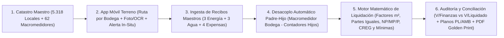

# 🛡️ CORABASTOS OS (ERP Corporativo & Motor de Liquidación de Servicios Públicos y Expensas Comunes) — Contrato Canónico de Arquitectura (SPEC.md)

> **Documento Canónico de Especificación (Spec-Anchored — SDD)**  
> **Versión:** 1.7.0 (Integración de Reglas Oficiales del Cliente + Sub-Módulo 1.6 Memoria de Cálculo & Reglas de Liquidación + Medidores Compartidos `/N` + Cero Datos Simulados Mayo vs. Junio 2025 Real)  
> **Fecha de Actualización:** 28 de Octubre de 2026  
> **Estado:** 🟢 VIGENTE & 100% BLINDADO PARA CONSTRUCCIÓN  
> **Ubicación Oficial:** `C:\Users\German Higuera\OneDrive\Documentos\Projects\corabastos`  
> **Puerto Dev Oficial Asignado:** `3013` (Registrado e Innegociable en `PROJECTS_PORTS_REGISTRY.md`)  
> **Backend Cloud Oficial:** Firebase Project `mjm-sistema-2026-aee19` (App `Corabastos OS` — Auth Email/Password + Firestore Offline-First)  
> **Principio Rector:** *«El código ya no es la fuente de la verdad; la especificación y los contratos de frontera lo son. El código es solo un subproducto derivado del contrato.»*

---

## 0. Leyes Marciales de Arquitectura, Estrategia Comercial "Land & Expand" & Gobernanza SDD

### 0.1 Las 5 Leyes Innegociables de Ingeniería (`arquitecto-sdd`)
1. **Contract-First Schema & Diccionario Único de Identidad (`src/contracts/domain-contracts.ts`):**
   - Prohibición absoluta de ambigüedades entre módulos. Los códigos de local (`codigoLocal`, ej. `"010001"`, `"02004B"`, `"980031"`), indicadores de bodega (`bodegaId`, ej. `"01"`..`"98"`), modalidades de cobro (`CONTADOR`, `COMUNAL`, `PRORRATEO`, `RED_FRIOS`, `BASICOS`) y planos contables (`PL109`, `PL008`, `PL009`, `PL003`, `PL007`, `PL004`, `PL141`, `PL253`, `PL086`, `PL087`, `PL250`, `AMB403`, `AMB408`) se rigen por un único contrato tipado en TypeScript + Zod (`< 250 líneas`).
2. **Headless Core + Thin UI (Prohibición de Monolitos `.tsx > 600 líneas`):**
   - **Headless Engine (`src/lib/liquidation-engine.ts`, `src/lib/reading-tasks-engine.ts`, `src/lib/bi-kpis-engine.ts`, `src/lib/accounting-export.ts`):** Funciones puras, deterministas, sin dependencias de React, que ejecutan el cálculo exacto al centavo sobre los **5.318 locales**, los **62 macromedidores comunales** y los **6 KPIs Longitudinales BI**.
   - **Thin UI (`src/components/**/*.tsx`):** Vistas modulares (`<= 600 líneas`) dedicadas exclusivamente a captura móvil en terreno, auditoría tabular y visualización ejecutiva.
3. **Estrategia de "Cables Pelados" (*Clean Boundary Harness*) & Escalamiento ERP Modular:**
   - El **Módulo 1 (Captura Móvil de Contadores + Liquidación de Servicios Públicos y Expensas)** es nuestro **Caballo de Troya ("Boleto de Entrada")** a la Corporación de Abastos de Bogotá S.A. (Corabastos).
   - La arquitectura nace con **"Cables Pelados"** (`src/contracts/erp-bridges.ts`) listos para enchufar progresivamente los módulos subsiguientes del ERP Administrativo (inspirados en la arquitectura probada de `frufresco` e `ingyemel_mantenimiento`) a medida que se cierren nuevas fases comerciales, sin reescribir el núcleo.
4. **Máquina de Estados Explícita (FSM) con Peaje de Evidencia en Terreno:**
   - Ninguna lectura de medidor ni periodo de liquidación cambia de estado en memoria volátil; toda transición persiste en Firebase v12 (`firestore`) con fallback offline-first en `localStorage`/`IndexedDB` para operación sin señal dentro de bodegas y sótanos de Corabastos.
5. **Iconografía Vectorial Exclusiva `lucide-react`:**
   - Prohibición total de emojis de texto Unicode (`⚡`, `💧`, `⚠️`, `✅`, etc.) en cualquier componente visual, botón, badge o reporte PDF. Uso exclusivo de íconos vectoriales `lucide-react` (`strokeWidth={1.75}`).
6. **Aislamiento Estricto de Interfaces & Frontera RBAC (`/captura` vs `/`):**
   - **Prohibición de Filtración Financiera:** El operario/lecturista en terreno NO debe tener visibilidad ni acceso a cifras globales de facturación corporativa, estados de cuenta de terceros, simulador de tarifas ni planos contables.
   - **Ruta `/captura` (PWA Móvil del Lecturista):** Dedicada exclusivamente a la captura ágil in-situ por cola de tareas pendientes, navegación ergonómica por zonas y bodegas, captura fotográfica probatoria y registro de novedades reglamentarias (`C, DETENIDO`, `C, TAPADO`, etc.).
   - **Ruta `/` (Shell Global del ERP Corporativo Corabastos OS):** Consola administrativa estructurada en **2 niveles jerárquicos estrictos**.
7. **Arquitectura de 2 Niveles del ERP Corporativo (`Shell ERP Global` $\rightarrow$ `Módulos de Dominio Autocontenidos`):**
   - **Nivel 1 (Navegación Principal del ERP en `src/app/page.tsx`):** Expone los **5 Macro-Módulos Corporativos de Corabastos OS**:
     1. **`MOD_1_SERVICIOS_EXPENSAS` (`Servicios Públicos & Expensas` — 100% Operativo):** Encapsula todo el proceso de lectura, desacoplo de macromedidores, vacancia de bodegas, liquidación de los 5.318 locales y rendición de cuentas individual.
     2. **`MOD_2_FACTURACION_CARTERA` (`Facturación DIAN, Cartera & Recaudo` — Cable Pelado Anillo 2)**
     3. **`MOD_3_CATASTRO_CONTRATOS` (`Catastro Inmobiliario, Bodegas & Arrendamientos` — Cable Pelado Anillo 3)**
     4. **`MOD_4_MANTENIMIENTO_CMMS` (`Mantenimiento Industrial & Red de Fríos` — Cable Pelado Anillo 4)**
     5. **`MOD_5_AMBIENTAL_PGIRS_SAC` (`Gestión Ambiental PGIRS, Básculas & SAC` — Cable Pelado Anillo 5)**
   - **Nivel 2 (Sub-Navegación Interna de cada Macro-Módulo):** Prohibido mezclar las sub-pestañas internas de `Servicios Públicos & Expensas` en la barra global del ERP; dichas sub-vistas (`1.1 Sábana & Cuenta Individual 360°`, `1.2 Estado de 68 Bodegas & Vacancia`, `1.3 Recibos Maestros & Macromedidores`, `1.4 Monitor de Corte & Tareas de Campo`) viven encapsuladas dentro del contenedor dedicado `src/components/UtilitiesErpModuleView.tsx`.

---

### 0.2 Hoja de Ruta Comercial "Land & Expand" (Del Boleto de Entrada al ERP Integral Corabastos)

Inspirado en el ecosistema modular de **`frufresco`** y el chasis operativo de **`Seguridad (Help! On Risks)`**, el sistema está estructurado en **5 Anillos de Expansión Comercial** visibles en la arquitectura del portal:

| Anillo / Fase Comercial | Módulo del ERP Corabastos | Origen de Trasplante (`Arsenal` / Proyectos) | Estado en `v1.0` |
| :--- | :--- | :--- | :--- |
| **ANILLO 1 (Boleto de Entrada — MVP Activo)** | **1A. Terminal Móvil de Lecturistas en Terreno (PWA + OCR IA)** **1B. Motor de Liquidación de Servicios Públicos y Expensas (5.318 Locales)** **1C. Conciliación Financiera (`V/Finanzas` vs `V/Liquidado`), Sabana Excel y Planos Contables** | Ingeniería Inversa `06. LIQUIDACION JUNIO 2025.xlsm` + `frufresco` (`/ops/compras` mobile UX) + `galeria-sticky-industrial` | 🟢 **100% Operativo (Nucleo Core)** |
| **ANILLO 2 (Expansión Corto Plazo)** | **Facturación Electrónica DIAN, Estado de Cuenta Digital por Comerciante (Golden Print PDF + WhatsApp) & Portal de Recaudo / Cartera** | `frufresco` (`/admin/commercial/billing`, WorldOffice/ERP export, Cartera) + `REF-PDF-GOLDEN-PRINT-MEMBRETE.md` | 🔌 **Cable Pelado Listo (`billing-bridge.ts`) + Vista Previa Ejecutiva** |
| **ANILLO 3 (Expansión Mediano Plazo)** | **Gestión Inmobiliaria de Bodegas, Contratos de Arrendamiento/Cesión de Locales, Áreas ($m^2$) y Catastro Técnico de Medidores** | `frufresco` (`SpecialAgreementsModule`) + `Seguridad` (`Debida Diligencia / SAGRILAFT` de Arrendatarios) | 🔌 **Cable Pelado Listo (`real-estate-bridge.ts`)** |
| **ANILLO 4 (Expansión Operativa)** | **Mantenimiento Industrial & CMMS de Infraestructura (Red de Fríos, Subestaciones, Macromedidores, Cubiertas y Aleros)** | `ingyemel_mantenimiento` (`maintenanceLifecycle.ts`, OT Kanban, Cronograma Preventivo) | 🔌 **Cable Pelado Listo (`cmms-bridge.ts`)** |
| **ANILLO 5 (Expansión Integral)** | **Gestión Ambiental PGIRS (Pesaje en Acopio de Residuos `NP/MP/P`), Control de Accesos / Básculas y SAC / PQRS de Comerciantes** | `frufresco` (`SAC PQR Widget + RCA Audit Modal`, Control Operativo) | 🔌 **Cable Pelado Listo (`pgirs-sac-bridge.ts`)** |

---

## 1. Misión del Sistema & Cadena Causal del Pipeline (Anillo 1)

### 1.1 El Problema Físico en el Gemba (Corabastos Hoy)
Mensualmente, Corabastos distribuye cerca de **`$3.861.030.410 COP`** en servicios públicos y expensas comunes entre **5.318 locales comerciales** (`126.125,15 m²` de área comercial en 60+ bodegas). Hoy el proceso sufre 4 fracturas críticas:
1. **Captura Manual Frágil en Campo:** Los operarios recorren miles de locales tomando fotografías de contadores de agua y energía; luego esas lecturas se digitan manualmente en hojas auxiliares (`[1]ENERGIA`, `[1]ACUEDUCTO`) que alimentan con `VLOOKUP` una macro-sábana de 10.7 MB (`06. LIQUIDACION JUNIO 2025.xlsm`).
2. **Fórmulas "Espagueti" en Macromedidores Comunales:** Cuando un local dentro de una bodega comunal instala contador propio, en el Excel deben editar manualmente la fórmula del macromedidor de esa bodega para restar la celda exacta del local hijo (ej. en `AGUA COMUNAL` fila 17: `=(D17-C17)-ACUEDUCTO!$F$309-$F$310-...-$F$3344`, con hasta 22 restas manuales por celda y múltiples errores `#REF!`).
3. **Detección Tardía de Anomalías:** Si un contador está detenido (`C, DETENIDO`), tapado (`C, TAPADO`), invertido o registra un salto atípico frente a su banda histórica (`PROMEDIO <` / `PROMEDIO >`), el hallazgo solo se descubre semanas después en oficina cuando ya cerró el mes.
4. **Descuadre Contable (`V/FINANZAS` vs. `V/LIQUIDADO`):** Cruzar los 3 recibos maestros de Energía, los recibos de Acueducto y las 4 facturas de expensas (Aseo, Residuos ECSA, Vigilancia, Policía) con notas crédito/débito, exenciones de la Corporación/Covial y topes de factura mínima genera diferencias de millones de pesos difíciles de auditar.

### 1.2 Cadena Causal del Pipeline Digital (`Corabastos OS`)

---

### 1.3 Marco Jurídico y Normativo Oficial: Reglamento Interno de Funcionamiento (Directiva de Gerencia No. 033-06)

La auditoría forense del documento oficial `ReglamentoInterno.pdf` (Título VII, Capítulos I y II, Artículos 42 al 47 y subsiguientes) dictamina las siguientes directrices legales que gobiernan el sistema:

1. **Naturaleza Jurídica: "Transferencia de Servicios Públicos" (Artículo 46):**
   - Corabastos S.A. **no es una Empresa de Servicios Públicos Domiciliarios (ESP)**, sino un gran suscriptor corporativo ante Enel-Codensa y Acueducto de Bogotá.
   - La recuperación de costos se rige jurídicamente bajo la figura de **"Liquidación y Transferencia de Servicios Públicos"** bajo un **régimen de solidaridad y a prorrata del área ocupada/arrendada ($m^2$)**, mientras concluye el proyecto de independización técnica total.

2. **Fórmulas Legales de Cobro (Título VII, Capítulo II):**
   - **Acueducto y Alcantarillado:** $\text{Total} = (\text{Consumo Contador } m^3 \times \text{Tarifa } m^3) + \text{Cuota Comunal Proporcional por Área } (m^2)$.
   - **Energía Eléctrica:** $\text{Total} = (\text{Consumo Contador } kWh \times \text{Tarifa } kWh) + \text{Alumbrado de Zonas Comunes / Aleros} + \text{Sobretasa Regulatoria CREG}$.
   - **Facultad de Aforos Técnicos:** Para locales con alto consumo o actividades especiales (lavaderos de canastillas, cuartos fríos, procesadoras), Corabastos está facultada legalmente para realizar **Aforos Técnicos de Capacidad** periódicos.

3. **Marco Regulatorio Ambiental PGIRS (Artículos 42 y 43):**
   - Regula el manejo y cobro de aseo y residuos sólidos bajo el **Plan de Gestión Integral de Residuos Sólidos (PGIRS)**.
   - Obliga a la separación en la fuente y fundamenta jurídicamente las tarifas diferenciales por nivel generador: **NP (No Productor / Productor Menor)**, **MP (Mediano Productor)** y **P (Gran Productor)**.
   - Prohíbe expresamente el ingreso clandestino de residuos externos a la corporación (tipificado como falta grave sujeta a sanción y sobretasa).

4. **Protocolo Legal de Reclamaciones de Facturación (Páginas 24–25):**
   - Todo comerciante inconforme con su liquidación dispone de un término perentorio para radicar reclamación formal ante el **Grupo de Facturación**.
   - **Visita Técnica Obligatoria:** La norma exige de forma taxativa que el personal técnico de Corabastos **debe practicar una visita técnica de inspección ocular al medidor y a las instalaciones del local** antes de emitir respuesta o ajustar la liquidación.
   - *Impacto en Corabastos OS:* Valida y blinda como requerimiento de ley el **Anillo 5 (Módulo SAC / PQRS)** y la **Terminal Móvil de Lecturas** con registro fotográfico georreferenciado e historial de anomalías (`C, DETENIDO`, `C, TAPADO`, saltos de consumo).

5. **Régimen de Cobro, Mora y Suspensión Física:**
   - La mora en el pago de la transferencia de servicios genera intereses moratorios comerciales y faculta a la Subgerencia Operativa a ejecutar la **suspensión y corte físico de la acometida**.
   - Se tipifica como infracción grave la manipulación de sellos, puentes clandestinos o reconexiones no autorizadas.

---

## 2. Restricciones Técnicas & Stack (`Help! On Risks / Seguridad Standard`)

- **Framework & Runtime:** Next.js 16 (App Router con Turbopack) + React 19 + TypeScript 5 (`strict: true`, cero `any`).
- **Puerto Dev Oficial:** **`3013`** (`"dev": "next dev --turbopack -p 3013"`).
- **Base de Datos, Auth & Storage:** **Firebase v12** (`firebase/firestore`, `firebase/auth`, `firebase/storage`) idéntico al stack de `Seguridad (helponrisks)` con capa de persistencia reactiva + **Semilla Determinista Local** generada directamente desde `06. LIQUIDACION JUNIO 2025.xlsm` para que el sistema opere al 100% desde el primer segundo con los **5.318 locales reales de Junio 2025**.
- **Estilos & UI:** Tailwind CSS v4 + Paleta Institucional de Alta Densidad (Inspirada en el estándar corporativo Navy/Emerald/Amber/Crimson de `Seguridad` e `Ingyemel`, con tipografía tabular `font-mono tabular-nums` para lecturas de kWh, $m^3$, áreas en $m^2$ y cifras en pesos COP).
- **Validación de Esquemas:** `zod` (`^3.24.2`) para validación estricta de lecturas de medidores, recibos maestros y reglas de liquidación.

---

## 3. Ingeniería Inversa Forense: Las Reglas Matemáticas Exactas de Corabastos (`06. LIQUIDACION JUNIO 2025.xlsm`)

Todo cálculo del motor `src/lib/liquidation-engine.ts` debe reproducir con precisión matemática las fórmulas extraídas de las 11 hojas del libro oficial de Junio 2025:

### 3.1 Censo Maestro y Tipología de Locales (`RESUMEN TOTAL` — 5.318 Unidades en 68 Bodegas)
Cada unidad o local comercial posee:
- `codigo` (`string`): Identificador único de 6 caracteres (ej. `"010001"`, `"02004B"`, `"840003"`). Los primeros 2 caracteres (`MID(codigo, 1, 2)`) determinan el `bodegaId` (`"01"` a `"98"`, abarcando **68 bodegas físicas**).
- `tipoBodega` (`string`): `"COMERCIANTES"`, `"BP MIN"`, `"BP MAY"`, `"RED FRIOS"`, `"PESCADOS"`, `"BANCOS"`, `"ADMINISTRACION"`, `"BAÑOS"`, etc.
- `areaM2` (`number`): Área en metros cuadrados. Suma total del catastro: **`126.125,15 m²`**.
- `modalidadEnergia` (`'CONTADOR' | 'COMUNAL' | 'PRORRATEO' | 'RED_FRIOS' | 'EXCLUIDO'`).
- `modalidadAcueducto` (`'CONTADOR' | 'COMUNAL' | 'PRORRATEO' | 'RED_FRIOS' | 'EXCLUIDO'`).
- `bloqueEnergia` (`'PRINCIPAL' | 'BODEGA_POPULAR'`): Define si el local se liquida en la sábana `ENERGIA_` (3.463 registros) o en `ENERGIA BP` (1.851 registros, con divisor `/N` en contadores compartidos de idéntica lectura y sobretasa CREG del **`15,7%`**).
- `categoriaResiduos` (`'NP' | 'MP' | 'P' | 'BASICOS' | 'EXCLUIDO'`): Clasificación generadora de residuos sólidos ECSA según PGIRS.
- `estadoOcupacion` (`'ACTIVO' | 'VACIO_CON_CONTRATO' | 'VACIO_SIN_CONTRATO_CORPORACION'`): Estado operativo y contractual del local (ver Sección 3.7).
- **Separación Estricta de Unidades Históricas (Físicas vs. Financieras):**
  - `energiaConsumoAntKw` (`number`, en `kWh`, col 22 de `ENERGIA_` y col 25 de `ENERGIA BP`) y `aguaConsumoAntM3` (`number`, en `m³`, col 17 de `ACUEDUCTO`): Consumo físico del mes inmediatamente anterior, usado en `/captura` para validar desviaciones físicas (`kWh` contra `kWh` y `m³` contra `m³`).
  - `energiaPromMin` / `energiaPromMax` (cols Y, Z de `ENERGIA_`) y `aguaPromMin` / `aguaPromMax` (cols U, V de `ACUEDUCTO`): Banda histórica financiera en **Pesos COP (`Total Liquidado`)**, usada en la consola administrativa y en la Cuenta Individual 360° para auditar desviaciones monetarias del cobro total.

---

### 3.2 Algoritmo de Desacoplo Automático Padre-Hijo en Macromedidores Comunales (`LECTURAS COMUNALES_` y `AGUA COMUNAL`)

En lugar de las fórmulas manuales del Excel que restan celdas individuales (`-ENERGIA_!$F$14-$F$1606...`), el motor implementa la **Regla de Árbol Padre-Hijo por Bodega**:

1. **Macromedidores de Aleros de Energía (`26 medidores`, filas 2 a 27 de `LECTURAS COMUNALES_`):**
   - Miden la iluminación perimetral/alero de cada bodega (`bodegaId`).
   - $\text{Consumo Alero Bodega } b = \text{Lectura Actual}_b - \text{Lectura Anterior}_b$.
   - $\text{Área Total Bodega } b = \sum_{i \in \text{Bodega } b} \text{Área}_i$.
   - A cada local $i$ de la bodega $b$ (excepto modalidad `RED_FRIOS`) se le asigna:
     $$\text{kWh Alero}_i = \text{Área}_i \times \frac{\text{Consumo Alero Bodega } b}{\text{Área Total Bodega } b}$$

2. **Macromedidores de Bodega Comunal de Energía (`12 medidores`, filas 28 a 39 de `LECTURAS COMUNALES_`):**
   - $\text{Consumo Bruto Macromedidor } b = \text{Lectura Actual}_b - \text{Lectura Anterior}_b$.
   - **Descuento Automático de Hijos con Contador:** El sistema identifica automáticamente todos los locales hijos $h \in \text{Bodega } b$ que estén vinculados aguas abajo del macromedidor y tengan modalidad `CONTADOR`:
     $$\text{Consumo Neto Comunal Energía}_b = \max\left(0,\; \text{Consumo Bruto Macromedidor } b - \sum_{h \in \text{HijosContador}(b)} \text{Consumo Individual kWh}_h\right)$$
   - Se reparte únicamente entre los locales con modalidad `COMUNAL` de esa bodega $b$:
     $$\text{kWh Bodega Comunal}_i = \text{Área}_i \times \frac{\text{Consumo Neto Comunal Energía}_b}{\sum_{k \in \text{Comunales}(b)} \text{Área}_k}$$

3. **Macromedidores de Agua Comunal (`24 medidores`, filas 2 a 25 de `AGUA COMUNAL`):**
   - Aplica exactamente el mismo desacoplo automático Padre-Hijo en metros cúbicos ($m^3$):
     $$\text{Consumo Neto Comunal Agua}_b = \max\left(0,\; (\text{Lectura Actual}_b - \text{Lectura Anterior}_b) - \sum_{h \in \text{HijosContadorAgua}(b)} \text{Consumo Individual } m^3_h\right)$$
     $$m^3\text{ Comunal}_i = \text{Área}_i \times \frac{\text{Consumo Neto Comunal Agua}_b}{\sum_{k \in \text{ComunalesAgua}(b)} \text{Área}_k}$$

---

### 3.3 Fórmulas Exactas de Liquidación de ENERGÍA (`ENERGIA_` y `ENERGIA BP`)

#### Parámetros Maestros del Mes (Valores de Referencia Junio 2025):
- **Tarifa Unitaria kWh (`$KW`):** **`$720,48 / kWh`**
- **Recibo 1 — Energía Corabastos Principal (`ENERGIA_`):**
  - Valor Consumo Factura (`H3477`): `$587.263.333`
  - Alumbrado Público Factura (`20%`): `$117.452.666,60`
  - Regulación CREG (`20%`): `$117.452.666,60`
  - Menos Valores Asumidos por Corporación (`$12.795.333`) y Covial (`$2.011.504`) $\rightarrow$ Base Asumida Neta: `$9.871.224,67`
  - **Valor Neto Servicio a Distribuir (`J3477`):** **`$459.939.441,73`**
  - **Tope Mínimo por Local (`J3494`):** **`$20.498`**
- **Recibo 2 — Energía Red de Fríos (`ENERGIA_`):**
  - Valor Factura Red Fríos (`L3483`): `$1.514.224` (Neto a distribuir `J3484`: **`$1.455.033`** + CREG 20%: **`$291.006,60`**).
- **Recibo 3 — Energía Bodega Popular (`ENERGIA BP`):**
  - Valor Consumo Factura (`D1858`): `$142.655.060`
  - Consumo Comunal BP (`D1859`, `20%`): `$28.531.012`
  - Valor Factura Neto BP (`G1858 = D1858 - D1859`): **`$114.124.048`**
  - Regulación CREG BP (`D1860`): `$22.397.270` (Tasa efectiva sobre consumo + comunal: **`15,7%`**)
  - **Tope Mínimo BP:** **`$20.489`**

#### Cálculo por Local en `ENERGIA_` (Predio Matriz — 3.463 Locales) y `ENERGIA BP` (Bodega Popular Contador Macro — 1.851 Locales):

##### A. Energía Predio Matriz (`ENERGIA_`) — Tres Grupos de Identificación (`CONTADOR`, `BODEGA COMUNAL`, `PRORRATEO`):
1. **Grupo 1 — Locales con Contador (`CONTADOR`):**
   - Se toma la lectura del medidor: $\text{Consumo Individual kWh}_i = \frac{\text{Lectura Actual}_i - \text{Lectura Anterior}_i}{N_{\text{compartido}}}$, donde $N_{\text{compartido}} \in \{1, 2, 3, 4\}$ es el número de locales que comparten el mismo contador y tienen la misma lectura (ej. filas `776, 802, 1571` `/3`; filas `1635..1638` `/4`; o reparto por área en `35PF`).
   - Se multiplica por el valor del $\text{kWh}$ (`$720,48`) + **`20%` Alumbrado Público General** (por $m^2$) + **`20%` Regulación CREG**.
   - **Si la bodega cuenta con Alero:** Se toma la lectura del contador del alero ($\text{Lectura Actual}_{\text{alero}} - \text{Lectura Anterior}_{\text{alero}}$), su consumo se divide entre el **Área Total de la Bodega que tiene el alero** y se multiplica por el área del local ($\text{kWh Alero}_i = \frac{\text{Consumo Alero}_b}{\text{Área Bodega}_b} \times \text{Área}_i$).
2. **Grupo 2 — Bodega o Contador Comunal (`COMUNAL`):**
   - Es una bodega con varios locales bajo un macromedidor comunal: se toma el consumo neto del contador comunal de la bodega (descontando automáticamente los hijos con contador individual de esa bodega), se divide entre el área de los locales comunales de la bodega ($\frac{\text{Consumo Neto Comunal}_b}{\sum \text{Área Comunales}_b} \times \text{Área}_i$), se multiplica por el valor del $\text{kWh}$ (`$720,48`) + los porcentajes (`20%` Alumbrado + `20%` CREG), y **si la bodega tiene Alero**, usa exactamente la misma formulación de Alero por $m^2$.
3. **Grupo 3 — Prorrateo (`PRORRATEO`):**
   - Se toma el valor resultante de restar al Valor Neto del Servicio de la factura la suma de `Bodegas Comunales` y `Contadores` ($\text{Bolsa Prorrateo} = \$459.939.441,73 - \sum \text{Comunales} - \sum \text{Contadores} = \$141.922.039,69$).
   - Esa diferencia se divide entre el **Área Total de Prorrateo** (`13.454,03 m²` $\rightarrow$ `$10.548,66 / m^2`), se multiplica por el área de cada local + los porcentajes (`20%` Alumbrado + `20%` CREG).
4. **Ajuste de Factura Mínima (`P = $20.498`) y Compensación de Prorrateo (`Q`):**
   - Si el subtotal de consumo de un local con contador en cero es menor a **`$20.498`**, paga el tope mínimo (`$20.498`) + los porcentajes de Alumbrado y CREG, y la suma de ajustes de mínima (`$9.343.662,66`) se descuenta proporcionalmente por $m^2$ a la bolsa de prorrateo (`-$694,49/m²`) para cuadrar al centavo con la factura.

##### B. Energía Bodega Popular Contador Macro (`ENERGIA BP` — 1.851 Locales):
Se identifican locales **con contador (`CONTADOR`)** y **sin contador (`PRORRATEO`)**:
1. **Locales con Contador (`CONTADOR`):**
   - $\text{Consumo kWh}_i = (\text{Lectura Actual}_i - \text{Lectura Anterior}_i) \times \text{Valor kWh } (\$720,48)$ + **`20%` de la factura de Bodega Popular como Consumo Comunal de la Bodega** (`$28.531.012 / 13.991,22 m²` $\times \text{Área}_i$) + **`20%` de la factura general como Alumbrado Público** (`$929,4644 / m²` $\times \text{Área}_i$) + **Regulación CREG** (`15,7%` BP + `20%` PM).
   - **Regla de Contadores con la Misma Lectura (Medidores Compartidos `/N`):** Los locales que comparten físicamente un contador y por tanto registran **la misma `Lectura Anterior` y `Lectura Actual`** en la hoja `ENERGIA BP` **se promedian / dividen en partes iguales (`/ N`)** entre los $N$ locales que tienen esa misma lectura (ej. `850001..850002` con `D=81379, E=84295` usan `=(E-D)/2`; `820264..820313` usan `=(E-D)/6`; `810738..810825` usan `=(E-D)/3`; `810077..810150` con `D=32652, E=34223` usan `=(E-D)/8 = 196,375 kWh`).
   - **Regla de Contadores en Cero (`Lectura Actual == Lectura Anterior`):** Los contadores cuyo consumo da **`0 kWh`** pagan el **Valor Mínimo (`$20.489`) + los porcentajes** (`20%` Consumo Comunal Bodega Popular + `20%` Alumbrado Público General + CREG).
2. **Locales en Prorrateo (`PRORRATEO` — Sin Contador):**
   - Se toma el valor neto de la factura de Bodega Popular (`$114.124.048`), se le resta el valor total consumido por los locales con contador (`$33.856.075,68`), y el resultado (`$80.267.972,32`) se divide entre el **Área Total de los locales identificados en Prorrateo** (`11.399,26 m²`) multiplicado por el área de cada puesto + los porcentajes de Comunal BP, Alumbrado Público y CREG.

---

### 3.4 Fórmulas Exactas de Liquidación de ACUEDUCTO Y ALCANTARILLADO (`ACUEDUCTO` — 5.312 Locales)

#### Parámetros Maestros del Mes (Valores de Referencia Junio 2025):
- **Total Factura General a Liquidar (`B5324`):** **`$234.123.110`** por **`21.437 m³`** $\rightarrow$ **Tarifa Unitaria (`$E$5330`):** **`$10.921,4494 / m³`** (que actúa a su vez como tope de **Factura Mínima = $1 m^3$**).
- **Factura Red de Fríos (`E5335`):** **`$7.489.970`** dividida entre `10.574,625 m²` = **`$708,2965 / m²`**.
- **Cargo Agua Comunal General (`10%` menos parte corporativa = `E5331`):** **`$22.691.941`** dividido entre `114.487,59 m²` = **`$198,2044 / m²`**.
- **Bolsa de Prorrateo Acueducto (`E5328`):** **`$51.378.880,56`** dividida entre `41.121,41 m²` de locales en `PRORRATEO` = **`$1.249,4436 / m²`**.

#### Cálculo por Local en `ACUEDUCTO`:
1. **Valor Consumo Medido o Comunal de Bodega (`H`):**
   $$\text{Valor Consumo}_i = \left(\frac{\text{Lectura Actual } m^3_i - \text{Lectura Anterior } m^3_i}{N_{\text{compartido}}} + \text{Consumo Comunal Bodega } m^3_i\right) \times \$10.921,4494$$
2. **Valor Prorrateo (`I`):**
   - Si es `PRORRATEO`: $\text{Área}_i \times \$1.249,4436$.
   - Si es `RED DE FRIOS`: $\text{Área}_i \times \$708,2965$.
3. **Ajuste de Mínima (`K`):** Si $(\text{Valor Consumo}_i + \text{Valor Prorrateo}_i) < \$10.921,45$, suma la diferencia hasta completar $1\;m^3$.
4. **Cuota Agua Comunal General (`M`):** $\text{Área}_i \times \$198,2044$ (para locales fuera de Red de Fríos).
5. **Total Acueducto Local (`N`):** $\text{Subtotal con Mínima}_i + \text{Cuota Agua Comunal General}_i$.

---

### 3.5 Fórmulas y Reglas Operativas de los Otros 4 Servicios Públicos (Expensas Generales)

| Servicio | Regla Operativa Oficial del Cliente | Liquidación Exacta en Libro Junio 2025 (`06. LIQUIDACION JUNIO 2025.xlsm`) |
| :--- | :--- | :--- |
| **1. VIGILANCIA (`VIGILANCIA`)** | **Se toma el valor de la factura de vigilancia, se resta el `20%` (asumido por la Corporación) y el `80%` restante se divide por el Área Total Arrendada ($m^2$).** | En la hoja `VIGILANCIA` de Junio 2025 se tomó la factura (`$1.457.589.006`), se restó la Nota Débito (`$11.488.020`) y el neto (`$1.446.100.986`) se dividió entre el Área Arrendada (`104.897,01 m²` = **`$13.785,9124 / m²`**). El motor soporta parametrizar el descuento corporativo (`0%` a `20%`) en los Recibos Maestros. |
| **2. POLICÍA (`POLICIA`)** | **Se toma el valor total de la factura y se divide por el número de locales arrendados.** | Factura de **`$215.384.615,00`** dividida en partes iguales entre **`5.300` locales arrendados** = **`$40.638,61` por local**. |
| **3. BARRIDO (`ASEO_`)** | **Se toma el valor de barrido (`20%` comercial de la operación de aseo) y se divide por el Área Total Arrendada ($m^2$).** | Valor neto de barrido **`$171.562.768,50`** dividido entre el Área Total Arrendada (`105.179,44 m²`) = **`$1.631,1436 / m²`**. |
| **4. RESIDUOS VERDES (`RESIDUOS` - ECSA)** | **Se caracteriza por 3 tipos de transferencia según productor:** • **No Productor (`NP`):** se transfiere el porcentaje asignado a `NP` (`20%` en regla general cliente; factor `0,4` = `17,87%` en hoja Junio 2025) dividido entre el área de los `NP` (`46.929,53 m²`). • **Mediano Productor (`MP`):** se transfiere el porcentaje asignado a `MP` (`30%` en regla general cliente; factor `1,2` = `17,40%` en hoja Junio 2025) dividido entre el área de los `MP` (`15.235,55 m²`). • **Productor (`P`):** se toma **el valor restante de la factura (`Factura - NP - MP`)** y se divide entre el área de los identificados como `P` (`42.882,34 m²`). | En Junio 2025 sobre **`$661.681.703,41`**: • Bolsa `NP`: `$118.241.499,82` (`$2.519,5543 / m²`) • Bolsa `MP`: `$115.160.421,25` (`$7.558,6630 / m²`) • Bolsa `P` (Restante): `$428.279.782,34` (`$9.987,3240 / m²`). |

---

### 3.6 Cola de Tareas de Cargue de Medidores por Corte y Zonas (`ReadingTaskQueue`)
Para cada corte mensual (ej. `CORTE-2025-06`), el motor instancia una **Cola de Tareas de Lectura (`ReadingTask`)** compuesta exclusivamente por los **1.835 medidores físicos** del censo real que requieren inspección en terreno, agrupados en **5 Zonas Operativas** idénticas a la estructura del libro oficial:

| Zona Operativa | Hojas Origen Excel | Universo Físico a Leer por Corte | Prioridad Operativa |
| :--- | :--- | :--- | :--- |
| **`ZONA_1_MACROMEDIDORES`** | `LECTURAS COMUNALES_` + `AGUA COMUNAL` | **62 tareas:** 26 Aleros Energía + 12 Bodegas Energía + 24 Macromedidores Agua Comunal | **CRÍTICA (Bloqueante de Prorrateo Comunal)** |
| **`ZONA_2_BANOS_PUBLICOS`** | `ACUEDUCTO` (Sección Baños) | **16 tareas:** 16 medidores de baterías sanitarias públicas | **ALTA** |
| **`ZONA_3_COMERCIANTES_PRINCIPAL`** | `ENERGIA_` + `ACUEDUCTO` | **1.375 tareas:** 989 contadores de Energía + 386 contadores de Acueducto en Bodegas Principal | **NORMAL (Barrido por Bodega)** |
| **`ZONA_4_BODEGA_POPULAR`** | `ENERGIA BP` + `ACUEDUCTO` | **351 tareas:** 199 contadores de Energía + 152 contadores de Acueducto en Bodega Popular (`BP MIN` / `BP MAY`, incluyendo medidores compartidos `/N`) | **NORMAL (Barrido por Bodega)** |
| **`ZONA_5_RED_FRIOS`** | `ENERGIA_` + `ACUEDUCTO` (`98`) | **Inspección de 31 puestos de refrigeración** (`980001`..`980031`) | **NORMAL** |

#### Máquina de Estados Finita (FSM) de cada Tarea de Lectura (`ReadingTaskState`):
- **`PENDIENTE`**: El medidor aún no ha sido leído en el corte activo. **En el celular del operador (`/captura`) solo se listan por defecto las tareas en estado `PENDIENTE`** de la zona/bodega seleccionada, mostrando un contador regresivo (`Quedan N pendientes`).
- **`COMPLETADA`**: Lectura física capturada + evidencia fotográfica validada dentro del rango histórico (`kWh` vs `energiaConsumoAntKw` o `m³` vs `aguaConsumoAntM3`). Al guardar, la tarea desaparece de la bandeja de pendientes del operador y el foco salta automáticamente al siguiente medidor contiguo.
- **`NOVEDAD_TECNICA`**: Medidor reportado con causal técnica oficial (`C, DETENIDO`, `M, DETENIDO`, `C, TAPADO`, `M, TAPADO`, `C, RETIRADO`, `C, SUSPENDIDO`) + fotografía obligatoria. Da por evacuada la tarea de terreno y activa la regla del **Art. 46 del Reglamento Interno**.
- **`CERRADO_SIN_ACCESO`**: Local reportado como `L, CERRADO`, `L, VACIO` o `NO PERMITIO INGRESO` + foto de la fachada/candado. Evacúa la tarea del operador y aplica el régimen de contador en cero / vacancia con contrato (factura mínima + porcentajes y expensas de ley).

---

### 3.7 Estado Operativo de las 68 Bodegas & Motor Jurídico-Contable de Vacancia (`BodegaStatusEngine`)
El sistema monitorea el estado individual de cada una de las **68 bodegas** (`bodegaId` `"01"`..`"98"`) y modela jurídicamente qué ocurre cuando un local o una bodega completa se encuentra vacía:

1. **Caso 1 — Local Activo en Operación (`ACTIVO`):**
   - Liquida consumo medido (`CONTADOR`, aplicando el divisor `/N` si comparte lectura con otros locales) o cuota comunal (`COMUNAL` / `PRORRATEO`) + Alumbrado + CREG + Acueducto + Residuos Verdes + Barrido + Vigilancia + Policía conforme al Artículo 46.
2. **Caso 2 — Local Vacío o Cerrado CON Contrato de Arrendamiento Vigente / Contador en Cero (`VACIO_CON_CONTRATO` — `L, VACIO` / `L, CERRADO`):**
   - Cuando el consumo físico en medidor es `0 kWh` y `0 m³`, paga:
     - **Energía:** Valor Mínimo (`$20.498` Predio Matriz / `$20.489` Bodega Popular) + los porcentajes de ley (`20%` Consumo Comunal BP si aplica + `20%` Alumbrado Público General + CREG).
     - **Acueducto:** Tope mínimo de $1\;m^3$ (`$10.921,45`) + Cuota Agua Comunal ($m^2$).
     - **Expensas:** Barrido ($m^2$), Vigilancia ($m^2$), Residuos Verdes según categoría (`NP/MP/P`) y Policía (cuota por local arrendado).
3. **Caso 3 — Local o Bodega Vacía SIN Contrato / Restituida a Corabastos (`VACIO_SIN_CONTRATO_CORPORACION`):**
   - **Prohibición de Sobrecosto a Vecinos:** Su área en $m^2$ se mantiene controlada y su costo se imputa automáticamente al centro de costo **`VALOR ASUMIDO CORPORACIÓN`**.

---

### 3.8 Hallazgos Forenses Críticos del Libro Oficial (`06. LIQUIDACION JUNIO 2025.xlsm`) y Correcciones de Auditoría
1. **Mapeo Exacto de Columnas de Consumo Físico Anterior (`Mayo 2025`) vs. Banda en Pesos (`PROMEDIO<` / `PROMEDIO>`):**
   - En las hojas `ENERGIA_` (columnas Y, Z), `ENERGIA BP` (columnas AB, AC) y `ACUEDUCTO` (columnas U, V), las columnas llamadas `PROMEDIO<` y `PROMEDIO>` están expresadas en **Pesos COP (`Total Liquidado`)**.
   - El **Consumo Físico Real del Mes Anterior (`Mayo 2025`)** se encuentra exclusivamente en:
     - `ENERGIA_` $\rightarrow$ **Columna `W`** (`W2: CONSUMO ANTERIOR KW`).
     - `ENERGIA BP` $\rightarrow$ **Columna `Z`** (`Z2: CONSUMO ANTERIOR KW`).
     - `ACUEDUCTO` $\rightarrow$ **Columna `R`** (`R2: CONSUMO ANTERIOR`).
   - **Prohibición Absoluta de Datos Simulados:** El archivo semilla `src/data/corabastos-junio-2025.json` extrae directamente dichas columnas reales (`W`, `Z`, `R`) junto con el divisor real de medidor compartido (`divisorContadorEnergia` y `divisorContadorAgua` extraído de las fórmulas `+(E-D)/N` del Excel). Queda terminantemente prohibido inventar o interpolar consumos o meses que no existan en el libro oficial.
2. **Detección de Doble Conteo en Columna `R` (`SUBTOTAL`) de la Hoja `RESUMEN TOTAL` del Excel Cliente:**
   - En `RESUMEN TOTAL`, la columna `I` (`ALCANT`) contiene el total de Acueducto y Alcantarillado (`$239.477.572,80`) y la columna `J` (`TOTAL ACUE ALCAN`) aplica `=+H4+I4` (`$239.477.572,80`).
   - La fórmula de la columna `R` (`SUBTOTAL`) del Excel original (`=SUM(F4:Q4)`) suma por error **tanto la columna `I` como la columna `J`**, duplicando **`$239.477.572,80 COP`** y mostrando `$3.861.030.409,65` en lugar de la suma real de los 6 servicios (**`$3.621.552.836,85 COP`**).

---

### 3.9 Motor de Inteligencia de Negocios (BI) & 6 KPIs Longitudinales (`100% Datos Reales Mayo 2025 vs. Junio 2025`)
Dentro del **Módulo 01 (`Servicios Públicos & Expensas`)**, el sub-módulo **1.5 Inteligencia BI & KPIs Longitudinales** opera **exclusivamente sobre los datos reales certificados en el libro oficial (`Mayo 2025 [Anterior]` vs. `Junio 2025 [Actual]`), con cero meses ficticios o simulados**:

1. **KPI 1 — Índice de Pérdidas y Remanente Comunal por Bodega ($\Delta$ Macromedidor Padre vs. Contadores Hijos):**
   - Mide qué porcentaje del consumo bruto de cada uno de los **62 macromedidores** (`38 Energía` + `24 Acueducto`) corresponde a consumo medido en contadores hijos ($\sum \text{Hijos}$) frente a remanente comunal ($\text{Bruto} - \sum \text{Hijos}$), y compara el `Consumo Neto Actual (Junio 2025)` contra el `Consumo Neto Anterior Real (Mayo 2025)` (`consumoAnteriorKw` col `F` de `LECTURAS COMUNALES_` y `consumoAnteriorM3` col `F` de `AGUA COMUNAL`).
2. **KPI 2 — Brecha de Absorción Financiera Corporativa (`V/Finanzas` vs. `V/Liquidado` + `Asumido Corporación`):**
   - Cuantifica por cada servicio (`Energía`, `Acueducto`, `Residuos Verdes`, `Barrido/Aseo`, `Vigilancia`, `Policía`) la relación entre la factura del proveedor (`V/Finanzas`), el valor liquidado a comerciantes (`V/Liquidado`) y el valor asumido por la Corporación.
3. **KPI 3 — Salud y Envejecimiento del Parque Metrológico (`1.835 Medidores Físicos`):**
   - Clasifica el estado real de los medidores en `OK` vs. anomalías reportadas en el Excel (`C, DETENIDO`, `M, DETENIDO`, `C, TAPADO`, `M, TAPADO`, `C, RETIRADO`, `REVISAR`, `L, CERRADO`, `L, VACIO`), cuantificando cuántos $m^2$ y COP operan en cada estado.
4. **KPI 4 — Intensidad Energética e Hídrica por $m^2$ (`kWh/m²`, `m³/m²`, `$/m²`) & Ranking Pareto de Bodegas y Locales:**
   - Calcula el benchmark real de consumo físico y costo por $m^2$ entre las **68 bodegas** y expone el **Top 15 Pareto de Locales** comparando su consumo físico real de Junio (`energiaConsumoIndivKw`, `aguaConsumoIndivM3`) contra su consumo físico real de Mayo (`energiaConsumoAntKw` col `W`/`Z`, `aguaConsumoAntM3` col `R`) y su facturación real (`calcTotalCop` vs. `totalAnteriorCop` col `AA` de `RESUMEN TOTAL`).
5. **KPI 5 — Comparativo Longitudinal Real Corte a Corte (`Mayo 2025 [Valor Anterior Excel]` vs. `Junio 2025 [Valor Actual Excel]`):**
   - Compara exclusivamente los **2 cortes reales existentes en el libro oficial (`2025-05 Mayo` vs. `2025-06 Junio`)**, servicio por servicio, utilizando las sumas exactas de las columnas `VALOR ANTERIOR` y `CONSUMO ANTERIOR` frente a `TOTAL LIQUIDADO` y `CONSUMO ACTUAL` del Excel, sin interpolar ni inventar meses inexistentes.
6. **KPI 6 — Eficiencia Operativa del Corte (`SLA de Lectura en Terreno` & Tasa de Locales Cerrados):**
   - Mide el avance real de las **1.835 tareas físicas** en las **5 Zonas Operativas** y la tasa de locales cerrados/vacíos (`L, CERRADO`, `L, VACIO`).

---

## 4. Especificación Funcional de Pantallas y Rutas Desacopladas (RBAC)

### 4.1 Ruta Independiente 1: Terminal Móvil del Operador — Cola de Tareas por Corte (`/captura` — 100% Mobile-First)
Aislada por RBAC de las cifras financieras corporativas:
1. **Cabecera de Corte Activo y Selector de Zona Operativa:**
   - Muestra el corte activo (`CORTE JUNIO 2025`), barra de progreso global de lecturas y píldoras de las **5 Zonas Operativas** (`Macromedidores [62]`, `Baños [16]`, `Comerciantes Principal`, `Bodega Popular`, `Red de Fríos`) más selector rápido de las **68 Bodegas** con badge del número de tareas pendientes en cada una.
2. **Bandeja Inteligente "Solo Pendientes" (` filter = 'PENDIENTES' ` por defecto):**
   - El operador en su celular **ve únicamente los medidores que le faltan por cargar en ese corte**.
   - Cuenta con un toggle secundario (`Pendientes [N]` | `Completadas [M]`) por si requiere auditar o corregir una lectura ya enviada en el turno.
3. **Tarjeta de Captura con Fotografía Probatoria, Semáforo Físico (`kWh`/`m³`) y Avance Automático:**
   - Exhibe Código del Local/Macromedidor, Serie del Medidor, Lectura Anterior, Consumo Físico Anterior (`kWh` o `m³`), y badge visible de **Medidor Compartido `/N` Locales** cuando aplica.
   - Al guardar una lectura válida (o reportar causal reglamentaria con foto), marca la tarea como `COMPLETADA` / `NOVEDAD_TECNICA`, la retira de la lista de pendientes y carga de inmediato la siguiente tarea pendiente de esa bodega.

### 4.2 Ruta Independiente 2: Shell Global del ERP Corporativo Estilo Portal de Operaciones MJM (`/` — Desktop 1600px) & Módulo Dedicado (`UtilitiesErpModuleView`)
La consola administrativa implementa íntegramente el **Sistema de Diseño y Arquitectura del Portal de Operaciones MJM (`Precision Clinical Slate` / `Obsidian Titanium`)**:

1. **Paleta Cromática y Variables de Sistema (`src/app/globals.css`):**
   - **Modo Día (`Precision Clinical Slate`):** `--sidebar-bg: #0B132B`, `--primary: #1E3A5F`, `--secondary: #0F172A`, `--tertiary: #D97706`, `--accent-mjm: #f7931b`, `--background: #F8FAFC`, `--surface: #FFFFFF`, `--surface-alt: #F1F5F9`, `--text-main: #0F172A`, `--text-muted: #64748B`, `--outline-color: #E2E8F0`.
   - **Modo Noche (`.dark` — `Obsidian Titanium`):** `--sidebar-bg: #060910`, `--background: #080C14`, `--surface: #101726`, `--surface-alt: #151F33`, `--text-main: #F8FAFC`, `--text-muted: #94A3B8`, `--outline-color: rgba(255, 255, 255, 0.08)`.
2. **Sidebar Izquierdo Colapsable MJM (`w-64` Desktop / Drawer Móvil en `src/app/page.tsx`):**
   - **Geometría y Persistencia:** Ancho `256px` (`w-64`) en escritorio con transición suave (`300ms`) a `w-0` cuando se oculta desde el botón `<Menu />` del Topbar (persistiendo el estado en `localStorage` bajo `corabastos_desktop_sidebar`), y drawer deslizable con backdrop desenfocado en móvil.
   - **Bloque Superior de Identidad Institucional (`p-4 border-b border-white/10`):** Escudo corporativo en contenedor `w-8 h-8 bg-white rounded-lg`, título en `text-[11px] font-bold uppercase tracking-tight` y subtítulo técnico en `text-[7.5px] text-[#f7931b] font-mono uppercase tracking-widest`.
   - **Secciones Jerárquicas con Micro-Títulos Monoespaciados (`navSections`):**
     - Encabezados en `text-[8.5px] font-mono font-bold tracking-widest text-slate-400/60 uppercase`.
     - Ítems con `px-3 py-1.5 rounded-lg text-[11.5px]`, ícono `size={16}`, estado activo **`bg-white/10 text-white font-semibold border-l-2 border-[#f7931b]`** con ícono en `#f7931b` y `<ChevronRight size={11} />`, y badge destacado en `#f7931b` con `<Sparkles />` para el Sub-Módulo BI.
     - Agrupa ordenadamente las **6 Sub-Vistas del Módulo 01 (`Servicios Públicos & Expensas`)** y los **Anillos 2 a 5 de la Suite ERP Corabastos (`Cables Pelados`)**.
   - **Pie de Firma Corporativa (`Footer Branding`):** Acción rápida de restauración/salida, leyenda `Powered by Delta CoreTech` y píldora `bg-white/5 border-white/5` con punto esmeralda pulsante (`w-1.5 h-1.5 rounded-full bg-emerald-400 animate-pulse`) mostrando el corte publicado.
3. **Topbar Ejecutivo Compañero (`sticky top-0 z-40 h-14` en `src/app/page.tsx`):**
   - **Izquierda:** Botón Hamburguesa (`<Menu size={16} />`) para alternar visibilidad del Sidebar (permitiendo modo pantalla completa `100%` para tablas anchas) + **Breadcrumb Dinámico** (`Módulo Activo > Sub-Vista Activa` con acento en `#1E3A5F` / `#f7931b`).
   - **Derecha:** Telemetría del Corte Activo (`$3.621,55M`), botón de apertura de `/captura` (`Terminal Móvil Operador`), selector Modo Día/Noche (`<Sun />` / `<Moon />`), campana `<Bell />` con **Popover Glassmorphism en Azul Profundo (`from-[#14284b]/95 via-[#0d1d36]/95 to-[#091528]/95`)** para Alertas Críticas del Corte, y avatar corporativo (`CO`).
4. **Nivel 2 — Contenedor Dedicado del Módulo 1 (`src/components/UtilitiesErpModuleView.tsx`):** Agrupa de forma autocontenida y sincronizada con el Sidebar las **6 sub-vistas operativas y analíticas** del proceso de Liquidación de Servicios Públicos y Expensas:
   1. **Sub-Vista 1.1 — Sábana Maestra de Liquidación (`5.318 Locales`), Conciliación (`V/Finanzas` vs `V/Liquidado`) & Cuenta Individual 360°:**
      - Implementa el estándar `galeria-sticky-industrial` de 3 niveles congelados (`top-0` Topbar corporativo, `top-14` Omnibox + Píldoras de telemetría, `top-[148px]` encabezados `<th>` sólidos `#0B132B`) y botón ícono esmeralda para exportación Excel/CSV.
   2. **Sub-Vista 1.2 — Mapa de Estado de las 68 Bodegas, Avance del Corte & Gestión de Vacancia (`src/components/BodegasStatusView.tsx`):**
      - Matriz visual y auditable de las **68 bodegas** (`01` a `98`) mostrando tipo de bodega, avance de tareas del corte y simulación en vivo del estado de ocupación (`ACTIVO`, `VACIO_CON_CONTRATO`, `VACIO_SIN_CONTRATO_CORPORACION`).
   3. **Sub-Vista 1.3 — Macromedidores Comunales (Desacoplo Padre-Hijo) & Centro de Recibos Maestros (`src/components/MasterReceiptsSimulatorView.tsx`):**
      - Auditoría de los **38 macromedidores de energía**, **24 macromedidores de agua comunal** y **16 baños públicos**, junto con el simulador de los 10 recibos maestros.
   4. **Sub-Vista 1.4 — Monitor de Corte y Cola de Tareas de Terreno:**
      - Resumen gerencial del avance del corte por las 5 zonas operativas, bitácora de lecturas recibidas en vivo y enlace directo a `/captura`.
   5. **Sub-Vista 1.5 — Inteligencia BI & 6 KPIs Longitudinales Corte a Corte (`src/components/BiLongitudinalKpisView.tsx`):**
      - Centro ejecutivo de analítica longitudinal que visualiza los **6 KPIs estratégicos** (Radar de Fugas en Macromedidores Padre-Hijo, Puente de Absorción Financiera Corporativa, Salud del Parque Metrológico de 1.835 medidores, Intensidad por $m^2$ y Ranking Pareto Top 15 con apertura directa de Cuenta Individual 360°, Comparativo Real Mayo 2025 vs. Junio 2025 y SLA Operativo por Zona).
   6. **Sub-Vista 1.6 — Memoria de Cálculo & Reglas de Liquidación (`src/components/LiquidationMethodologyView.tsx`):**
      - Subsección ejecutiva y pedagógica dedicada que documenta y demuestra matemáticamente cómo se liquidó el corte activo (`Junio 2025`) paso a paso y al centavo en cada uno de los **7 bloques de cobro** (`Energía Predio Matriz`, `Energía Bodega Popular Macro`, `Acueducto y Alcantarillado`, `Vigilancia`, `Policía`, `Barrido / Aseo`, y `Residuos Verdes NP / MP / P`), mostrando las fórmulas exactas del cliente y del Excel, las áreas divisoras, las bolsas de prorrateo, la regla de contadores compartidos (`/N`) y contadores en cero (`Mínima + %`).
- **Expediente Modal / Drawer: Cuenta Individual 360° y Rendición de Cuentas por Local (`src/components/LocalAccountModal.tsx`):**
  - Se abre al hacer clic en cualquier local desde la Sábana Maestra, el Mapa de Bodegas o el Ranking Pareto del Sub-Módulo BI, e incluye la **Memoria de Cálculo Individual Reemplazada** con las cifras exactas del local seleccionado.

---

## 5. Matriz de Ensamble de Refacciones del Arsenal Global & Criterios Gherkin

### 5.1 Refacciones del Arsenal Global Integradas
| Necesidad en Corabastos | Refacción del Arsenal / Proyecto Hermano | Aplicación en `corabastos` |
| :--- | :--- | :--- |
| Shell Operativo, Sidebar Colapsable y Paleta | `mjm-frontend` (`src/layouts/DashboardLayout.jsx` + `src/index.css`) | Sidebar `#0B132B` con acento `#f7931b`, Topbar con Breadcrumb, Modo Oscuro/Claro y Popover Glassmorphism Azul |
| Captura rápida en terreno con una mano | `REF-ERGONOMIA-TECLADO-TAB-ENTER.md` + `REF-INPUT-NUMERICO-SIN-CERO-Y-COMA-DECIMAL.md` | Avance inmediato entre medidores pendientes con `Enter` y validación numérica limpia |
| Navegación móvil de 1 toque en bodega | `REF-SUBNAV-STICKY-1TAP-MOBILE.md` | Selector de Zona y Bodega con contador de pendientes en `/captura` |
| Sábana de 5.318 locales sin lag de renderizado | `galeria-sticky-industrial` + `estandar-galerias-frufresco` | Contenedor `1600px`, 3 niveles sticky docked y diccionarios $O(1)$ |
| Cuenta Individual 360° e informes de auditoría | `REF-PDF-GOLDEN-PRINT-MEMBRETE.md` | Expediente individual de rendición de cuentas listo para impresión a 300 DPI |
| Stack y persistencia híbrida Cloud | Proyecto Firebase `mjm-sistema-2026-aee19` | Next.js 16 + React 19 + TypeScript 5 + Firebase v12 (`Auth` + `Firestore`) + Zod |

### 5.2 Criterios de Aceptación Verificables (Gherkin Estricto)

- **Escenario 1: Cola de Tareas "Solo Pendientes" por Corte y Zona en `/captura`**
  - **Given** que se abre el `Corte Junio 2025` y el operario ingresa desde su celular a `/captura` seleccionando `Zona 3 — Comerciantes Principal` -> `Bodega 01`,
  - **When** visualiza su lista de trabajo y registra la lectura válida del medidor `010001` (validada en `kWh` contra `energiaConsumoAntKw`),
  - **Then** la tarea `010001` cambia a estado `COMPLETADA`, desaparece inmediatamente de la bandeja de pendientes del operador, el contador de pendientes de la `Bodega 01` disminuye en `1` y la pantalla carga automáticamente el siguiente medidor pendiente.

- **Escenario 2: Bodega o Local Vacío (Con Contrato vs. Sin Contrato / Asumido por Corporación)**
  - **Given** una bodega con locales en estado `VACIO_CON_CONTRATO` (`L, VACIO`) y locales en estado `VACIO_SIN_CONTRATO_CORPORACION` (restituidos a Corabastos),
  - **When** el motor ejecuta `recalculateAllLocales`,
  - **Then** al local `VACIO_CON_CONTRATO` se le liquida Factura Mínima (`$20.498`) + Alumbrado/Agua Comunal ($m^2$) + Expensas de ley, mientras que al local `VACIO_SIN_CONTRATO_CORPORACION` se le mantiene su área ($m^2$) en el denominador técnico de la bodega (sin subirle la tarifa $/m^2$ a los comerciantes activos) y su costo se traslada a la bolsa contable `VALOR ASUMIDO CORPORACIÓN`.

- **Escenario 3: Cuenta Individual 360° y Rendición de Cuentas por Local**
  - **Given** cualquier local de los 5.318 en la consola administrativa (ej. `010001` o un puesto de Bodega Popular con contador compartido `/N`),
  - **When** el auditor hace clic sobre la fila del local para abrir su `Cuenta Individual 360°`,
  - **Then** el sistema despliega el expediente completo con ficha catastral, trazabilidad del macromedidor padre de su bodega, desglose matemático de las fórmulas del Art. 46 para los 6 servicios, comparativo contra consumo físico anterior (`kWh`/`m³`) y banda financiera (`PROMEDIO <` / `PROMEDIO >`), y permite imprimir el soporte oficial de rendición de cuentas.

- **Escenario 4: Inteligencia BI & 6 KPIs Longitudinales Corte a Corte (`1.5 Inteligencia BI & KPIs`)**
  - **Given** el Módulo 01 (`Servicios Públicos & Expensas`) con el censo activo de `5.318 locales`, `62 macromedidores` y `1.835 tareas físicas`,
  - **When** el director financiero o auditor abre la Sub-Vista `1.5 Inteligencia BI & KPIs Longitudinales`,
  - **Then** el sistema calcula y renderiza reactivamente los **6 KPIs Longitudinales** (1. Pérdidas y saltos `> +20%` en Macromedidores Padre-Hijo, 2. Brecha de Absorción Financiera `V/Finanzas` vs `V/Liquidado` + `Asumido Corporación`, 3. Salud del Parque Metrológico y costo migrado a prorrateo por medidores detenidos/tapados, 4. Intensidad `kWh/m²` y `m³/m²` por Bodega + Top 15 Pareto de Locales con clic a Cuenta 360°, 5. Comparativo Longitudinal Real Mayo 2025 vs. Junio 2025 sin meses simulados, y 6. SLA de lectura en terreno y tasa de locales cerrados).

---

## 6. Plan de Ejecución Atómico

- `[x]` **Tarea 1.0:** Ingeniería inversa completa de `06. LIQUIDACION JUNIO 2025.xlsm` y formalización de `SPEC.md` + registro de puerto `3013` en `PROJECTS_PORTS_REGISTRY.md`.
- `[x]` **Tarea 2.0:** Extracción automatizada del dataset semilla real desde `06. LIQUIDACION JUNIO 2025.xlsm` (`src/data/corabastos-junio-2025.json` con el censo completo de los **5.318 locales**, **38 macromedidores de energía**, **24 macromedidores de agua**, **16 medidores de baños** y parámetros de los **10 recibos maestros**).
- `[x]` **Tarea 3.0:** Inicialización del proyecto Next.js 16 + React 19 + TypeScript 5 + Tailwind CSS v4 + Firebase v12 (`mjm-sistema-2026-aee19`) + Zod + Lucide Icons en el puerto `3013`.
- `[x]` **Tarea 4.0:** Construcción del Headless Core (`src/contracts/domain-contracts.ts` + `src/lib/liquidation-engine.ts`) implementando el desacoplo Padre-Hijo y las fórmulas exactas de Energía, Acueducto, Residuos (`0.4 / 1.2 / P`), Aseo, Vigilancia y Policía bajo el Reglamento Interno (Directiva 033-06).
- `[x]` **Tarea 5.0:** Desacoplo RBAC de rutas (`/captura` para operario en terreno vs `/` para Consola Ejecutiva) y estandarización de la Sábana Maestra bajo `galeria-sticky-industrial` (`1600px`, 3 niveles sticky docked).
- `[x]` **Tarea 6.0:** Actualización del contrato `SPEC.md` v1.3.0 incorporando Arquitectura ERP de 2 Niveles, Cola de Tareas por Corte y Zonas, Estado de las 68 Bodegas / Motor de Vacancia, Cuenta Individual 360° por Local y corrección forense de unidades (`kWh`/`m³` vs `COP`).
- `[x]` **Tarea 7.0:** Enriquecimiento del dataset semilla (`src/data/corabastos-junio-2025.json`) y contratos (`src/contracts/domain-contracts.ts`, `src/contracts/erp-bridges.ts`) con `energiaConsumoAntKw`, `aguaConsumoAntM3`, `estadoOcupacion` y estructura de Zonas/Tareas por Corte.
- `[x]` **Tarea 8.0:** Evolución de `/captura` (`src/app/captura/page.tsx` + `src/lib/reading-tasks-engine.ts`) como **Cola de Tareas Pendientes por Corte y Zonas** (Macromedidores, Baños, Comerciantes Principal, Bodega Popular, Red de Fríos) con filtro por defecto de solo pendientes, validación física `kWh`/`m³` y salto automático.
- `[x]` **Tarea 9.0:** Construcción del **Shell ERP de 2 Niveles (`src/app/page.tsx`)**, el **Contenedor Dedicado del Módulo 01 (`src/components/UtilitiesErpModuleView.tsx`)**, el **Tablero de Estado de las 68 Bodegas y Vacancia (`src/components/BodegasStatusView.tsx`)** y el **Modal/Expediente de Cuenta Individual 360° y Rendición de Cuentas por Local (`src/components/LocalAccountModal.tsx`)**.
- `[x]` **Tarea 10.0:** Certificación `npx tsc --noEmit` (`EXIT 0`), verificación funcional en `http://localhost:3013` y `http://localhost:3013/captura`, y dictamen independiente de `auditor-tirano-sdd`.
- `[x]` **Tarea 11.0:** Actualización SDD `SPEC.md` v1.4.0 e implementación del **Sub-Módulo 1.5 Inteligencia BI & 6 KPIs Longitudinales Corte a Corte** (`src/lib/bi-kpis-engine.ts` + `src/components/BiLongitudinalKpisView.tsx`) integrado en `src/components/UtilitiesErpModuleView.tsx`.
- `[x]` **Tarea 12.0:** Actualización SDD `SPEC.md` v1.5.0 e implementación del **Sidebar Colapsable, Topbar Ejecutivo, Sistema de Color (`#0B132B` / `#1E3A5F` / `#f7931b`) y Popover Glassmorphism del Portal de Operaciones MJM** en `src/app/globals.css`, `src/app/page.tsx` y `src/components/UtilitiesErpModuleView.tsx`.
- `[x]` **Tarea 13.0:** Actualización SDD `SPEC.md` v1.6.0 con las reglas oficiales de negocio del cliente, erradicación de meses simulados y extracción de las columnas reales de Mayo 2025 (`W`, `Z`, `R`) y divisores de contadores compartidos (`/N`).
- `[x]` **Tarea 14.0:** Actualización SDD `SPEC.md` v1.7.0 e implementación de la **Sub-Vista 1.6 Memoria de Cálculo & Reglas de Liquidación (`src/components/LiquidationMethodologyView.tsx`)** y la explicación matemática reemplazada local por local en `src/components/LocalAccountModal.tsx`.
