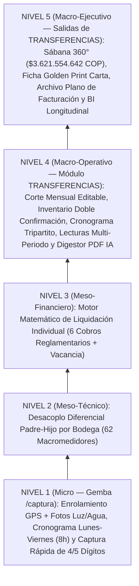

# 🛡️ CORABASTOS — Sistema de Liquidación de Servicios Públicos, Expensas Comunes & Captura de Medidores (SPEC.md)

> **Documento Canónico de Especificación (Spec-Anchored — SDD)**  
> **Versión:** 4.5.0 (Arquitectura Ascendente Micro a Macro: Enrolamiento Georreferenciado 1-Tap, Fotos Duales de Nicho Luz/Agua, Aprendizaje Continuo EMA $\alpha = 0,35$ sobre Tiempos Reales $\Delta t$, Cronograma Exclusivo Entre Semana Lunes–Viernes en Jornadas de 8 Horas (`480 min`) sobre Base de `22 Días Hábiles/Mes` con Candado de `30 Días`, Captura Ágil de `4 Últimos Dígitos` con Guarda Anti-Rollover Fantasma (`reconstructReadingFromTrailingDigits` con frontera 70/30%) y Excepción de `5 Dígitos` en Alta Carga, Mapa de Calor Estricto de las 68 Bodegas (+ Chip Aislado de los 16 Baños Públicos), Bandas Históricas Auto-Alimentadas Normalizadas a Base 30 Días con Colchón Mínimo (`Deadband Floor`: 3 m³ Agua / 15 kWh Luz) y Auto-Adaptación por 2 Cortes Verificados Seguidos, e Informe de Anomalías con Re-Verificación Prioridad 0 a Ceguera Total en Terreno)  
> **Fecha de Actualización:** 10 de Noviembre de 2026  
> **Estado:** 🟢 VIGENTE & CONTRATO CANÓNICO DE EJECUCIÓN  
> **Ubicación Física en Disco:** `c:\Projects\corabastos`  
> **Puerto Dev Oficial:** `3013` (`next dev --turbopack -p 3013`)  
> **URL Producción Activa:** `https://corabastos-servicios.web.app` (Sitio oficial en Firebase Project `mjm-sistema-2026-aee19`)  
> **Vigencia Operativa Programada:** Ventana activa de 30 días hasta `2026-12-10T23:59:59-05:00` (`TrialExpirationGuard.tsx`, `firestore.rules`, `storage.rules`)  
> **Atlas Topológico Estructural:** Anexo pericial en [`PROJECT_ATLAS.md`](./PROJECT_ATLAS.md) *(Cláusula de Prelación: prevalece taxativamente este `SPEC.md` v4.5.0).*  
> **Principio Rector:** *«El dato nace en el barro del Gemba: primero se enrola y georreferencia el contador físico para establecer la ruta ideal; luego se captura el consumo con agilidad de 4 dígitos entre semana; y finalmente se gobierna todo el ciclo de Transferencias bajo la fecha de corte oficial sin promesas falsas ni mocks cosméticos.»*

---

## 🏛️ ARQUITECTURA ASCENDENTE: DE LO MICRO A LO MACRO (5 NIVELES OPERATIVOS)

---

## 📱 NIVEL 1 (Micro — Gemba): App Móvil de Enrolamiento, Cronograma Lunes–Viernes y Captura Rápida (`/captura`)

### 1.1 Fase 1.A — Enrolamiento Georreferenciado & Línea Base en Gemba (Día Cero)
1. **Cuarteto de Captura Inicial en Gemba (`MeterRouteSurveyItem` en `src/contracts/domain-contracts.ts`):**
   - **Identidad de Bodega y Local (`bodegaId`, `codigo`):** Frontera topológica primaria que agrupa al macromedidor padre y a sus medidores hijos.
   - **Coordenada GPS Real (`latitude`, `longitude`, `accuracyMeters`):** Capturada vía HTML5 Geolocation API mediante pulsación 1-Tap (*"Fijar Posición"*), acompañada de referencia de ubicación (`referenciaPasillo`).
   - **Fotografías de Emplazamiento / Contadores (Hasta 2 Fotos por Parada):**
     - **Foto del Contador de Luz (`hasPositionPhoto`, `positionPhotoLocalKey`, `positionPhotoStorageUrl`):** En todas las paradas con medición eléctrica.
     - **Foto del Contador de Agua (`hasPositionPhotoWater`, `positionPhotoWaterLocalKey`, `positionPhotoWaterStorageUrl`):** Únicamente cuando el local o la bodega posee medidor físico de acueducto.
   - **Tiempos Reales entre Tomas (`tiempoLlegadaMs`, `tiempoSalidaMs`, `duracionServicioSegundos`, `deltaTrasladoSegundos`):**
     - Registra automáticamente la duración de servicio en el punto ($T_{\text{service}}$) y el tiempo de traslado desde la parada anterior ($\Delta t_{\text{walk}}$).

### 1.2 Fase 1.B — Aprendizaje Continuo (ML EMA), Compactación en Jornadas de 8h (Solo Lunes–Viernes) y Candado de 30 Días
1. **Aprendizaje Continuo Determinista (`emaDuracionServicioSegundos`, `emaDeltaTrasladoSegundos` con $\alpha = 0,35$):**
   - La primera toma establece la **Línea Base Empírica** para trazar la **Ruta Ideal** (`1° → 2° → 3°...`).
   - Cada toma subsecuente actualiza la media móvil exponencial ($\text{EMA}_t = 0,65 \cdot \text{EMA}_{t-1} + 0,35 \cdot X_t$ en `saveMeterRouteSurvey` y `buildCompositePhysicalStops`), ajustando el tiempo esperado por parada (`estimatedStopSeconds`) según la realidad del terreno.
2. **Compactación en Jornadas de 8 Horas (`480 min` brutos) Exclusivamente Entre Semana (`Lunes a Viernes`):**
   - **Prohibido programar lecturas en Sábado o Domingo (`soloEntreSemanaLunesViernes = true`).** El mes operativo base cuenta con **`22` días hábiles (`diasHabilesBaseMes = 22`)**.
   - El motor [`computeWorkforceCapacityPlan()`](./src/lib/reading-tasks-engine.ts) empaqueta bodegas completas indivisibles en turnos completos de **8 horas** (`jornadaBrutaMinutos = 480`, `jornadaEfectivaMinutos` parametrizable, por defecto `420 min`), asignando a cada jornada un día hábil (`diaSemanaLabel` $\in \{\text{LUNES}, \text{MARTES}, \text{MIERCOLES}, \text{JUEVES}, \text{VIERNES}\}$ via `advanceWeekdaysUtcMs`).
   - A medida que la Ruta Ideal ahorra tiempo, el operador **trabaja días completos de 8 horas pero menos días hábiles al mes** (`diasAhorradosVsMesCompleto = max(0, 22 - diasRequeridosAlMes)`).
3. **Tres Restricciones Duras del Cronograma (`WorkforceShiftDayBucket`):**
   - **Bodega Indivisible en el Mismo Día:** El macromedidor padre y todos sus hijos se leen el mismo día hábil.
   - **Candado de 30 Días Ajustado a Día Hábil (`gapCicloLecturaDias = 30` + `snapUtcMsToWeekday`):** Cada bloque diario proyecta su siguiente lectura a `+30 días` ajustando automáticamente al día hábil más cercano si cae en fin de semana.
   - **Flexibilidad Intra-Día:** El operador visualiza el protocolo del día con la secuencia sugerida de la Ruta Ideal, pero puede alterar el orden dentro del mismo día si un pasillo está temporalmente obstruido por descargue.

### 1.3 Fase 1.C — Protocolo de Captura Rápida en Puesto: Selector Luz/Agua, 4 Últimos Dígitos (y 5 en Alta Carga) + Novedades
1. **Diferenciación Físico-Catastral y Selector Rápido de Servicio en Parada (`CompositePhysicalStop`):**
   - Todas las bodegas activas tienen medición de energía (`1.084` tareas individuales/compartidas + `38` macromedidores), pero solo **24 bodegas** tienen macromedidor o contadores individuales de agua (`526` tareas individuales/compartidas + `24` macromedidores); las otras **44 bodegas** comparten acometida o prorratean agua.
   - Al llegar al puesto, la interfaz pre-selecciona según el mapeo (`[⚡ Solo Luz]`, `[⚡💧 Luz y Agua]` o `[💧 Solo Agua]`), permitiendo al operador conmutar con 1 toque si aplica, mientras preserva intactas las **1.688 tareas atómicas** subyacentes en `completedTaskIds` y `fieldOverridesMap` (Invariante 3 de BDD-Guard).
2. **Captura Ágil por los 4 Últimos Dígitos (con Excepción de 5 Dígitos en Energía de Alta Carga):**
   - **Regla Estándar (4 Últimos Dígitos):** Para maximizar velocidad en terreno, el operador toma la fotografía del contador e ingresa únicamente los **4 últimos dígitos** del odómetro.
   - **Reconstrucción Automática con Acarreo (`reconstructReadingFromTrailingDigits` en `src/lib/reading-tasks-engine.ts`):**
     $$\text{Módulo } M = 10^d \;(d \in \{4, 5\}), \quad \text{Prefijo} = \left\lfloor \frac{\text{LectAnt}}{M} \right\rfloor \cdot M, \quad \text{SufijoAnt} = \text{LectAnt} \bmod M$$
     $$\text{LecturaReconstruida} = \begin{cases} \text{Prefijo} + \text{SufijoDigitado} & \text{si } \text{SufijoDigitado} \ge \text{SufijoAnt} \\ \text{Prefijo} + M + \text{SufijoDigitado} & \text{si } \text{SufijoDigitado} < \text{SufijoAnt (acarreo de millar)} \end{cases}$$
   - **Excepción de 5 Dígitos (`requiresFiveDigitCapture`):** En los contadores de energía de alta carga (macromedidores `MACRO_ENERGIA` como `BOD COMUNAL 12` o locales con consumo $\ge 8.000\text{ kWh/mes}$ como `980004`, `850013`, `150010`), el sistema exige **5 dígitos** ($M = 100.000$) o permite conmutar `4D / 5D`.
3. **Selector de Novedades, Validación en Caliente contra Banda Histórica y Re-Verificación a Ciegas:**
   - **Validación en Caliente (`evaluateConsumptionAgainstBand` en `src/lib/historical-bands-engine.ts`):** Apenas el operador digita los 4 (o 5) últimos dígitos en el puesto, la app evalúa al instante si el consumo físico calculado ($kWh$ o $m^3$) se sale de la **Banda Histórica `[bandaMinFisica, bandaMaxFisica]`** del puesto. Si se sale (`requiereDobleValidacionMovil === true`), solicita confirmación inmediata en sitio o selección de novedad antes de pasar al siguiente puesto.
   - **Tareas Prioritarias de Re-Verificación a Ciegas (`FieldReverificationTask` con `lecturaCiegaOculta = true`):** Cuando el administrador envía una anomalía a terreno desde `Transferencias`, se inyecta al inicio del cronograma móvil del operador una orden prioritaria que **oculta el número digitado en la primera toma** (`lecturaPrimeraTomaInterna`), exigiendo nueva lectura desde cero y segunda fotografía con timestamp y GPS.
   - Si el medidor presenta anomalía (`DETENIDO`, `TAPADO`, `RETIRADO`, `SUSPENDIDO`, `REVISAR`) o el local está sin acceso (`L, CERRADO`, `L, VACIO`, `NO PERMITIO INGRESO`), el operador selecciona la novedad y adjunta la foto obligatoria.
   - Cero cadenas Base64 en Firestore o `localStorage` (almacenamiento binario en `IndexedDB` + Firebase Storage `/tenants/corabastos/evidencias/...`).

---

## ⚡ NIVEL 2 (Meso-Técnico): Desacoplo Diferencial Padre-Hijo por Bodega (62 Macromedidores)

1. **Saneamiento de Hijos Válidos por Bodega:**
   $$\text{HijosVálidos}(m) = \text{uniq}(m.\text{hijosContadorCodigos}).\text{filter}(c \Rightarrow \text{local}(c)?.bodegaId === m.bodegaId)$$
2. **Cálculo Diferencial Anclado al Neto Semilla (`consumoNetoKw` / `consumoNetoM3`):**
   $$\text{ConsumoNetoActual}_m = \max\left(0,\; \text{ConsumoNetoSemilla}_m + \Delta\text{Padre}_m - \Delta\text{Hijos}_m\right)$$
3. **Propagación por $m^2$ con Guarda Anti-`NaN` (`areaM2 === 0`, ej. `ACOM-16`):**
   - Si el factor comunal por $m^2$ varía ($|\Delta\text{Factor}_m| > 10^{-7}$), actualiza el consumo comunal de cada local aplicable de esa bodega.

---

## 💰 NIVEL 3 (Meso-Financiero): Liquidación Individual del Local (Los 6 Cobros Reglamentarios)

1. **Cuadre Exacto en $T=0$ (`Junio 2025 = $3.621.554.642 COP` con `$0 COP` de desviación):**
   - **Energía Total (`Principal + Bodega Popular`):** `$856.707.455 COP`
   - **Acueducto y Alcantarillado:** `$239.477.169 COP`
   - **Barrido / Aseo:** `$173.508.673 COP`
   - **Residuos Sólidos ECSA (`NP/MP/P`):** `$678.935.044 COP`
   - **Vigilancia Privada:** `$1.457.539.601 COP`
   - **Policía Nacional:** `$215.386.700 COP`
2. **Prohibición de `totalJunioCop` y `totalAnteriorCop` Crudos:** Uso exclusivo de `computeOfficialMayTotalCop`.
3. **Identidad Contable de Vacancia Reversible (`occupancyMap`):**
   - En `VACIO_SIN_CONTRATO_CORPORACION`: `calcTotalCop = 0` (facturable al comerciante) y `calcAssumedCorporationCop = rawTotalCop` (asumido por Corabastos), cuadrando al peso con el KPI 2.

---

## 🏛️ NIVEL 4 Y NIVEL 5 (Macro-Operativo & Ejecutivo): Módulo Maestro Único de **`Transferencias`**

Toda la gestión administrativa y contable de la consola ejecutiva (`/`) se articula alrededor del módulo maestro **`Transferencias`**, gobernado transversalmente por la **Configuración de Fecha de Corte Mensual Editable (`TransferCutoffConfig` en `src/contracts/domain-contracts.ts`)**:

### 4.0 Eje Rector: Configuración Editable de Fecha de Corte por Mes (`TransferCutoffConfig`)
- Cada periodo mensual (`periodo`, ej. `2025-06`) tiene fechas de corte editables en la configuración del sistema (`fechaCorteEnergiaIso`, `fechaCorteAcueductoIso`, `fechaExpedicionFichaIso`) para sincronizarse con el día real en que la empresa de energía (Enel) o de acueducto (EAAB) realiza la lectura de frontera y macromedidores.
- Todo el módulo de **`Transferencias`** filtra, liquida, compara y emite documentos bajo la lógica de estos cortes mensuales.

### 4.1 Sub-Módulo 1 — Inventario de Puestos Agrupados por Bodega (Editable con Doble Confirmación y Trazabilidad)
- Visualización y gestión de los **5.318 puestos comerciales** agrupados en sus **68 bodegas**.
- **Edición Controlada de Características por Puesto:** Permite editar características catastrales y operativas (`areaM2`, `modalidadEnergia`, `modalidadAcueducto`, `categoriaResiduos`, `estadoOcupacion`, `digitosContadorEnergia`).
- **Doble Confirmación y Trazabilidad Inmutable (`PuestoInventoryAuditEntry`):** Toda modificación exige doble confirmación explícita (`confirmadoDoblePaso: true`) y justificación obligatoria (`motivoJustificacion`), registrando `valorAnterior`, `valorNuevo`, `actorUid` y `timestampIso` en la bitácora de auditoría (`audit_log`).

### 4.2 Sub-Módulo 2 — Cronograma Integral de 3 Hitos (Estilo MJM) & Mapa de Calor de las 68 Bodegas por Grupo de Lectura
1. **Calendario Ejecutivo de 3 Hitos Mensuales:**
   - **Hito 1 — Lectura Interna en Terreno:** Jornadas de 8 horas de Lunes a Viernes alineadas con la fecha de corte y el gap de 30 días.
   - **Hito 2 — Facturación del Servicio:** Recepción, cargue y conciliación de los recibos maestros de los operadores de servicios públicos.
   - **Hito 3 — Expedición de Documento de "Ficha":** Fecha de emisión de las fichas individuales de transferencia por puesto y cierre contable del corte.
2. **Mapa de Calor Interactivo de las 68 Bodegas por Grupo de Lectura (`BodegaHeatmapCell` y `BodegaHeatmapLens` en `src/contracts/domain-contracts.ts`):**
   - Una vez conformados los grupos diarios de lectura (`WorkforceShiftDayBucket`), la interfaz despliega la matriz térmica de las **68 bodegas** agrupadas por su jornada asignada (`Día 1 · Lunes`, `Día 2 · Martes`, etc.), con **3 lentes intercambiables en 1 clic**:
     1. **Lente `AVANCE_RUTA` (Ejecución en Tiempo Real):**
        - `VERDE_OPTIMO`: Bodega 100% evacuada (macromedidor padre + hijos leídos sin anomalías críticas).
        - `AMBAR_EN_CURSO`: Bodega en lectura activa ($1\% - 99\%$ de avance).
        - `AZUL_PROGRAMADA`: Bodega programada para su grupo de lectura entre semana ($0\%$ leído aún).
        - `ROJO_CRITICO`: Bodega con medidores detenidos, tapados o locales cerrados que exigen segunda visita.
     2. **Lente `CONSUMO_FUGAS` (Desacoplo Padre vs. Hijos & Variación Intermensual):**
        - Resalta en calor rojo las bodegas con salto atípico de consumo comunal ($> +20\%$) o alta brecha $\text{Macromedidor} - \sum \text{Hijos}$ (posibles fugas o conexiones directas).
     3. **Lente `TIEMPO_OPERACION` (Fricción en Gemba medida por ML):**
        - Colorea cada bodega según `segundosPromedioPorParada` aprendidos por EMA ($\alpha = 0,35$), evidenciando cuellos de botella físicos (contadores en altura o congestión de cargue).
   - **Drill-Down Instantáneo:** Al hacer clic en cualquier celda de bodega del mapa de calor, se despliega la ficha del grupo de lectura con su macromedidor padre, la secuencia `1° → 2° → 3°` de sus puestos, fotografías de evidencia y estado de cada contador.

### 4.3 Sub-Módulo 3 — Visor de Lecturas de Uno o Varios Periodos Agrupados
- Consulta y comparación transversal de lecturas seleccionando **uno o múltiples periodos de corte** simultáneamente (ej. `Mayo 2025` vs `Junio 2025`), agrupadas por **Bodega**, **Zona Operativa** o **Macromedidor**, con variación física ($kWh$, $m^3$, $\%$), estado metrológico y evidencia fotográfica.

### 4.4 Sub-Módulo 4 — Cargue y Configuración de Recibos y Macromedidores vía PDF + Digestión IA (Refacción `frufresco`)
- Ensamble del protocolo **`REF-INGESTA-EMAIL-IA-DIGESTOR-ERP`** (mesa de auditoría de documentos):
  - Permite cargar los archivos PDF de las facturas globales (Enel, EAAB, ECSA, Vigilancia, Policía) y soportes de los **62 macromedidores**.
  - El digestor IA/heurístico extrae fechas de lectura del operador (sugiriendo la fecha de corte del periodo), consumos brutos, tarifas unitarias y valores netos, pre-llenando el simulador de recibos maestros (`MasterReceiptsConfig`) para revisión y confirmación humana antes de irrigar las 5 bolsas de prorrateo.

### 4.5 Sub-Módulo 5 — Sábana 360°, Expedición de "Ficha" Golden Print y Archivo Plano de Facturación
- **Sábana Maestra 360°:** Tabla sticky (`borderCollapse: 'separate'`) con partición exacta De Morgan (`1.295 CONTADOR + 4.023 COMUNAL = 5.318`).
- **Documento "Ficha" Individual (`#golden-print-certificate`):** Estado de cuenta y certificado de transferencia imprimible en formato Carta vertical (`@media print` con `.app-print-hide`).
- **Generación de Archivo Plano de Facturación (`buildSabanaCsvContent`):** Exportación CSV/plano contable (`es-CO`) con las 5.318 filas listas para ejecutar la facturación a cada puesto comercial.

### 4.6 Sub-Módulo 6 — Bandas Históricas Auto-Alimentadas (`[BandaMin, BandaMax]`), Informe de Anomalías y Re-Verificación en Campo
1. **Bandas en Unidades Físicas ($kWh$ / $m^3$) + Proyección en Pesos ($COP$):**
   - La banda de cada puesto (`HistoricalConsumptionBandProfile` en `src/contracts/domain-contracts.ts`) se calcula y alimenta en **unidades físicas reales ($kWh$ y $m^3$)** para que los incrementos tarifarios de Enel o EAAB no disparen falsas alarmas de consumo, proyectando su impacto monetario (`impactoDesviacionCop`) con la tarifa vigente del corte.
   - **Colchón Mínimo Anti-Ruido (`Deadband Floor`):** Se establece un piso mínimo absoluto de `3 m³` para agua y `15 kWh` para energía (`MIN_DEADBAND_FLOOR_M3`, `MIN_DEADBAND_FLOOR_KWH` en `src/lib/historical-bands-engine.ts`) por debajo del cual no se disparan anomalías para evitar falsos positivos en locales secos.
2. **Normalización por Días Reales de Corte ($\text{Base 30 Días}$) y Alimentación Mensual:**
   - Para neutralizar las variaciones de calendario de los cortes editables (ej. cortes de 27 días vs. 34 días), el consumo físico se normaliza a base 30 días ($\text{ConsumoNorm30d} = C_t \times \frac{30}{\Delta\text{díasCorte}}$) antes de evaluar y alimentar la serie.
   - En cada cierre de corte mensual en `Transferencias`, la serie histórica conserva hasta `12` periodos (`HISTORICAL_WINDOW_MAX_PERIODS = 12`) y actualiza su **Media Histórica Aprendida ($\mu_t$)** mediante EMA con $\beta = 0,25$ ($\mu_t = 0,75 \cdot \mu_{t-1} + 0,25 \cdot C_t$).
   - Corredor semilla ($\pm 30\%$) para $<3$ cortes y ajuste por desviación estándar ($\pm 1,5\sigma_t$, acotado entre $\pm 20\%$ y $\pm 35\%$) para $\ge 3$ cortes.
3. **Válvula de Higiene Estadística, Auto-Adaptación y Re-Anclaje:**
   - Meses con novedades metrológicas (`DETENIDO`, `TAPADO`, `RETIRADO`, `SUSPENDIDO`) o vacancia (`VACIO`) no alimentan la media $\mu_t$.
   - **Regla de Auto-Adaptación por 2 Cortes Verificados Seguidos:** Si un puesto incrementa su consumo y es verificado en campo con foto consecutivamente durante 2 cortes (`verificadoEnCampoConsecutivo: true`), la válvula se abre automáticamente para asimilar el nuevo nivel de consumo sin intervención manual.
   - Si un local cambia de giro o arrendatario, se re-ancla la línea base (`reanchorHistoricalBandBaseline`) con doble confirmación y trazabilidad.
4. **Informe de Anomalías y Re-Verificación a Ciegas Total (Prioridad 0 en `/captura`):**
   - Lista puestos con `SOBRECONSUMO_CRITICO` ($> \text{BandaMax}$) o `SUBCONSUMO_ATIPICO` ($< \text{BandaMin}$).
   - Al pulsar *"Enviar a Re-Verificación en Campo"*, genera una `FieldReverificationTask` con **`prioridadCero: true`** que se fija arriba del todo en la app móvil.
   - **Protocolo de Ceguera Total:** Oculta tanto la primera lectura como la lectura anterior y la banda esperada, exigiendo ingresar la lectura completa mirando el odómetro y capturar foto obligatoria con timestamp y GPS posteriores a la orden.
   - Al resolverse, confronta lado a lado **Lectura 1 / Foto 1 vs. Lectura 2 / Foto 2** en la mesa de decisiones de `Transferencias`.

---

## 🔒 LEYES MARCIALES DE INGENIERÍA Y VERIFICACIÓN (`BDD-GUARD`)

1. **TypeScript Estricto & Límite de Líneas:** Cero `any`, cero `@ts-ignore`, cero casts forzados; todo archivo en `src/` (excepto el JSON semilla) `<= 590` líneas.
2. **Formato `es-CO` e Iconografía:** Uso exclusivo de `src/lib/formatters.ts` y `lucide-react` con `strokeWidth={1.75}`.
3. **Aprobación Mecánica Obligatoria (`EXIT 0`):**
   - `npx.cmd tsc --noEmit`
   - `node scripts/verify-corabastos-invariants.mjs`
   - `cmd.exe /c "npm run build"`
